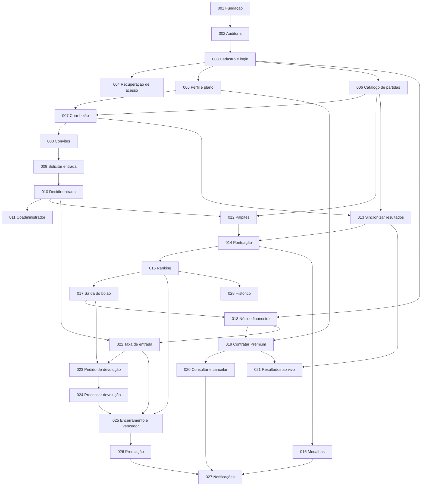

# Mapa de Specs — Palpite League

- **Status:** aprovado. Atualizado em 31/10/2026: as 28 Specs foram geradas e aprovadas (SPEC-020 a SPEC-024 em 30/10/2026 e SPEC-025 a SPEC-028 em 31/10/2026) e as questões OPEN-88 a OPEN-166, criadas nessas Specs, foram resolvidas com a aprovação delas. Em 23/10/2026 haviam sido incorporadas as decisões da proposta de resolução das questões em aberto (aprovada integralmente).
- **Etapa:** Spec-Driven Development, decomposição do projeto em Specs (prompt principal).
- **Escopo deste documento:** somente o índice ordenado de Specs, as análises que o sustentam e as questões em aberto. Nenhuma Spec individual, código, banco de dados, endpoint ou escolha tecnológica nova foi produzida.
- **Fonte de verdade:** artefatos de `docs/` (visão, personas, RF, RB, RNF, modelo de domínio, casos de uso, drivers, ADRs, arquitetura consolidada e validação do Mercado Pago).

---

## 1. Análise da baseline

### 1.1 Principais comportamentos identificados

1. Identidade e acesso: cadastro, autenticação, recuperação de acesso, perfil e plano (RF01–RF05).
2. Planos e assinatura Premium: contratação, consulta, cancelamento, expiração e efeitos no limite de criação (RF06–RF08; RB01–RB12, RB55, RB56).
3. Catálogo esportivo: times, rodadas e partidas obtidos de uma API externa (UC01 passo 3; ADR-0002).
4. Criação e configuração de bolão com regras imutáveis e limite por plano (RF09–RF11, RF18, RF38; UC01).
5. Convite, solicitação de entrada, aceite das regras, entrada tardia, aprovação e confirmação da participação (RF12–RF16; UC03).
6. Papéis por bolão: administrador, coadministrador e participante (RF17; UC08).
7. Palpites com prazo e exclusividade de modalidade (RF20–RF22; UC04).
8. Apuração: resultado oficial via API, pontuação, ranking, melhor da rodada e medalhas (RF23–RF29; UC05).
9. Resultados ao vivo para bolões criados por usuários Premium (RF24; RB06, RB31, RB58).
10. Operações financeiras de teste: taxa de entrada, devolução, premiação e registro das movimentações (RF30, RF31, RF33, RF34, RF37, RF19; UC03, UC06, UC07).
11. Saída do bolão (RF32; UC06).
12. Encerramento, vencedor e premiação (RF35–RF37; UC07).
13. Notificações e histórico (RF39, RF40).

### 1.2 Dependências entre comportamentos

### 1.3 Regras de negócio e invariantes associados (principais)

- Regras do bolão imutáveis após a criação: taxa, premiação, período, partidas e desempate (RB15, RB23, RB43, RB51).
- Um único tipo de palpite por partida e no máximo um palpite por participante e partida (RB25, RB26; UC04 pós-condição).
- Palpite só até o início da partida (RB27, RB28, RF22).
- Resultado oficial somente pela API esportiva, nunca manual (RB29, RB30, RB60, RF25).
- Pontuação fixa: 2 pontos por resultado, 5 por placar exato, 0 por erro (RB34–RB37).
- Limites de criação: 1 bolão no plano Gratuito e 10 no Premium; participação sem limite (RB02, RB03, RB05, RB57).
- Medalha para todos os empatados na maior pontuação da rodada, sem efeito em pontos ou prêmio (RB39–RB41).
- Saída sem devolução automática; devolução só após autorização administrativa e confirmação do provedor; remoção unilateral proibida (RB44–RB48).
- Participação com taxa só se confirma após aprovação e pagamento confirmado (RB18, RB22, RB62).
- Plano Premium só ativa após confirmação válida do pagamento (RB55).
- Toda movimentação financeira é registrada e vinculada a usuário e operação (RB53, RB54).
- Autorização e regras de domínio validadas no backend (ADR-0005; RNF12).

### 1.4 Requisitos não funcionais transversais

Associados às Specs em que se aplicam, sem Specs próprias: RNF01, RNF02, RNF03, RNF04, RNF05, RNF06, RNF07, RNF09, RNF11, RNF12, RNF13, RNF14, RNF16, RNF18, RNF20. RNF08, RNF10, RNF15 e RNF17 são específicos de integrações e aparecem nas Specs correspondentes.

### 1.5 Restrições e decisões arquiteturais já tomadas

- ADR-0001 (Aceito): backend como monólito modular.
- ADR-0002 (Aceito para o protótipo, prova técnica pendente): API-Football isolada em adaptador; testes com respostas simuladas.
- ADR-0003 (Aceito, validação sandbox pendente): Mercado Pago em teste; Assinaturas para Premium e Checkout Pro para taxa; devolução e premiação validadas por operação; simulador permitido e sempre identificado; sem repetição automática de cobrança, reembolso ou repasse.
- ADR-0004 (Aceito): React com JavaScript e Vite, Node.js com Express, SQLite com SQL direto e `better-sqlite3`; hospedagem fora do escopo.
- ADR-0005 (Aceito): invariantes validadas no backend.
- Sem dinheiro real, sem credenciais de produção, sem segredos no repositório (RNF15).
- As validações práticas que envolvam API esportiva, sandbox financeiro ou carga devem ser confirmadas com a equipe antes de executar (arquitetura consolidada §4.11 e §6.11).

### 1.6 Inconsistências, lacunas e decisões em aberto

Registradas na seção 4 como `OPEN-XX`. Nenhuma foi resolvida silenciosamente.

---

## 2. Mapa ordenado de Specs

Convenções: `—` significa que a baseline não traz item correspondente. Specs marcadas como **técnica** têm sua necessidade demonstrada nos artefatos de arquitetura (regra 3 do prompt) e entregam comportamento verificável.

### Índice

| ID | Nome | Depende de |
| --- | --- | --- |
| SPEC-001 | Fundação técnica do monólito modular (técnica) | — |
| SPEC-002 | Trilha de auditoria (técnica) | 001 |
| SPEC-003 | Cadastro e autenticação de usuário | 001, 002 |
| SPEC-004 | Recuperação de acesso | 003 |
| SPEC-005 | Perfil do usuário e consulta do plano | 003 |
| SPEC-006 | Consulta de times, rodadas e partidas via adaptador esportivo | 001, 003 |
| SPEC-007 | Criação, configuração e consulta das regras do bolão | 002, 003, 005, 006 |
| SPEC-008 | Convites para o bolão | 007 |
| SPEC-009 | Solicitação de entrada, aceite das regras e entrada tardia | 008 |
| SPEC-010 | Decisão administrativa de entrada e confirmação sem taxa | 009 |
| SPEC-011 | Promoção a coadministrador | 010 |
| SPEC-012 | Realização e alteração de palpite dentro do prazo | 006, 007, 010 |
| SPEC-013 | Sincronização de resultados oficiais | 001, 006, 007 |
| SPEC-014 | Cálculo automático da pontuação | 012, 013 |
| SPEC-015 | Ranking acumulado, desempate e consulta de desempenho | 007, 010, 014 |
| SPEC-016 | Melhor jogador da rodada e medalhas | 013, 014 |
| SPEC-017 | Saída voluntária do bolão | 010, 012, 015 |
| SPEC-018 | Núcleo financeiro de teste (técnica) | 001, 002, 003 |
| SPEC-019 | Contratação do Premium e ativação dos recursos | 005, 018 |
| SPEC-020 | Consulta e cancelamento da assinatura, expiração e downgrade | 007, 019 |
| SPEC-021 | Resultados ao vivo em bolões Premium | 007, 013, 019 |
| SPEC-022 | Pagamento da taxa de entrada e confirmação financeira da participação | 010, 018 |
| SPEC-023 | Solicitação e decisão administrativa de devolução | 017, 018, 022 |
| SPEC-024 | Processamento da devolução no provedor de teste | 018, 023 |
| SPEC-025 | Encerramento automático e determinação do vencedor | 015, 017, 022, 024 |
| SPEC-026 | Solicitação e processamento da premiação | 018, 025 |
| SPEC-027 | Notificações de eventos | 010, 013, 016, 019, 020, 026 |
| SPEC-028 | Histórico do bolão | 012, 013, 014, 015 |

---

### SPEC-001 — Fundação técnica do monólito modular (técnica)

- **Objetivo:** disponibilizar a estrutura executável localmente do monólito modular, com os módulos de responsabilidade previstos, acesso à persistência com transações, registro técnico de eventos e uma suíte de testes que roda sem credenciais externas.
- **Valor entregue:** base verificável (a aplicação sobe, responde e persiste de forma atômica) sobre a qual todas as demais Specs são implementadas. Não contém regra de negócio.
- **RF:** — (habilitadora de todos).
- **RB:** —.
- **RNF:** RNF02, RNF05, RNF18, RNF19, RNF20.
- **Caso de uso/fluxo:** — (transversal; ver arquitetura consolidada §14.1–§14.3).
- **Entidades:** nenhuma de domínio.
- **Drivers:** DA-01, DA-05, DA-06.
- **ADRs:** ADR-0001, ADR-0004, ADR-0005.
- **Dependências:** nenhuma.
- **Justificativa da posição:** todas as Specs exigem módulos, persistência transacional, testes independentes de provedores e log técnico; a necessidade está demonstrada em ADR-0001, ADR-0004 e RNF19.
- **Questões em aberto relacionadas:** resolvidas OPEN-03, OPEN-06, OPEN-35 e OPEN-39 a OPEN-44; em aberto OPEN-48 (confirmação da versão do Node.js).

### SPEC-002 — Trilha de auditoria (técnica)

- **Objetivo:** registrar operações auditáveis com ator, ação, objeto afetado, data e hora em UTC e resultado, identificando o sistema como ator nas ações automáticas, sem armazenar segredos.
- **Valor entregue:** evidência consultável de quem fez o quê, reutilizada por cadastro, autenticação, aceite, palpite, decisões administrativas, sincronizações e movimentações.
- **RF:** — (habilitadora; RF31 e RF40 dependem de registros dessa natureza).
- **RB:** RB65 (registro do aceite) e RB53 (registro das movimentações) como consumidores.
- **RNF:** RNF04, RNF16, RNF01, RNF20.
- **Caso de uso/fluxo:** — (transversal; arquitetura consolidada §4.3 e §7.7).
- **Entidades:** registro de auditoria (não existe no modelo conceitual; ver OPEN-31).
- **Drivers:** DA-03, DA-04.
- **ADRs:** ADR-0001, ADR-0005.
- **Dependências:** SPEC-001.
- **Justificativa da posição:** cadastro e autenticação já são operações auditáveis (arquitetura consolidada §4.3); a trilha precisa existir antes das Specs que a utilizam.
- **Questões em aberto relacionadas:** OPEN-08, OPEN-31, OPEN-39, OPEN-45, OPEN-46 e OPEN-47, todas resolvidas.

### SPEC-003 — Cadastro e autenticação de usuário

- **Objetivo:** permitir que um visitante crie uma conta e que um usuário com credenciais válidas seja autenticado.
- **Valor entregue:** acesso identificado ao sistema, pré-condição de todos os casos de uso.
- **RF:** RF01, RF02.
- **RB:** RB01 e RB02 (plano Gratuito como plano inicial, a confirmar).
- **RNF:** RNF01, RNF06, RNF11, RNF13, RNF14.
- **Caso de uso/fluxo:** pré-condição de UC01–UC08 (usuário autenticado).
- **Entidades:** Usuario (a Carteira é reservada e não é criada; OPEN-22).
- **Drivers:** DA-04, DA-06.
- **ADRs:** ADR-0001, ADR-0004, ADR-0005.
- **Dependências:** SPEC-001, SPEC-002.
- **Justificativa da posição:** nenhuma funcionalidade protegida pode ser especificada ou testada sem identidade.
- **Questões em aberto relacionadas:** resolvidas OPEN-05, OPEN-06, OPEN-09 e OPEN-22; OPEN-49 a OPEN-53 resolvidas com a aprovação da SPEC-003.

### SPEC-004 — Recuperação de acesso

- **Objetivo:** permitir que o usuário solicite a recuperação de acesso, receba por um canal simulado um token de uso único válido por 30 minutos e defina uma nova senha.
- **Valor entregue:** o usuário que perdeu a senha volta a acessar a conta.
- **RF:** RF03.
- **RB:** —.
- **RNF:** RNF01, RNF02 (parte), RNF04 e RNF16 (via SPEC-002), RNF14 (por extensão do fluxo de autenticação), RNF20.
- **Caso de uso/fluxo:** — (RF03 não possui caso de uso).
- **Entidades:** Usuario.
- **Drivers:** DA-04.
- **ADRs:** ADR-0004, ADR-0005, ADR-0007, ADR-0008.
- **Dependências:** SPEC-001, SPEC-002, SPEC-003.
- **Justificativa da posição:** exige a conta existente. Fica separada por ter fluxo e critérios de validação próprios.
- **Questões em aberto relacionadas:** OPEN-07 resolvida; OPEN-54 e OPEN-55 resolvidas com a aprovação da SPEC-004.

### SPEC-005 — Perfil do usuário e consulta do plano

- **Objetivo:** permitir visualizar e alterar o nome, consultar plano atual, status e recursos disponíveis e comparar os planos Gratuito e Premium, com o catálogo de planos como fonte única de limites e recursos.
- **Valor entregue:** o usuário gerencia seus dados e sabe o que seu plano permite (limite de bolões e recurso ao vivo).
- **RF:** RF04, RF05.
- **RB:** RB01, RB02, RB03, RB05, RB06.
- **RNF:** RNF01, RNF11, RNF14 (por extensão).
- **Caso de uso/fluxo:** UC02 (passo 1 de consulta dos planos e consulta do plano, RF05).
- **Entidades:** Usuario.
- **Drivers:** DA-04.
- **ADRs:** ADR-0004, ADR-0005, ADR-0008.
- **Dependências:** SPEC-001, SPEC-003.
- **Justificativa da posição:** estabelece o atributo de plano que a criação de bolão (SPEC-007) consulta. Nesta Spec só o plano Gratuito é alcançável; o Premium passa a existir na SPEC-019.
- **Questões em aberto relacionadas:** resolvidas OPEN-05 e OPEN-09; OPEN-56 e OPEN-57 resolvidas com a aprovação da SPEC-005.

### SPEC-006 — Consulta de times, rodadas e partidas via adaptador esportivo

- **Objetivo:** disponibilizar ao sistema o catálogo de times, rodadas e partidas por meio de um adaptador isolado da API esportiva, com implementação simulada para desenvolvimento e testes.
- **Valor entregue:** o administrador passa a ver partidas e rodadas reais para selecionar; o sistema não inventa partidas quando a fonte está indisponível.
- **RF:** RF18 (pré-requisito da seleção); RF23 compartilha o mesmo adaptador (SPEC-013).
- **RB:** RB24, RB29.
- **RNF:** RNF08, RNF18, RNF19, RNF20, RNF01, RNF14 (por extensão).
- **Caso de uso/fluxo:** UC01 passo 3 e exceção A2.
- **Entidades:** Time, Rodada, Partida.
- **Drivers:** DA-02, DA-05.
- **ADRs:** ADR-0002, ADR-0001, ADR-0004, ADR-0008.
- **Dependências:** SPEC-001, SPEC-003.
- **Justificativa da posição:** a criação de bolão exige partidas e rodadas para seleção. A integração real fica condicionada à prova técnica do ADR-0002; até lá, a Spec cobre o contrato do adaptador e o uso simulado.
- **Questões em aberto relacionadas:** resolvidas OPEN-01 (decisão aprovada; prova técnica a executar pela equipe), OPEN-02, OPEN-09 e OPEN-37; OPEN-58 a OPEN-60 resolvidas com a aprovação da SPEC-006.

### SPEC-007 — Criação, configuração e consulta das regras do bolão

- **Objetivo:** permitir que um usuário dentro do limite do plano crie um bolão com nome, período, taxa de entrada, modelo de premiação, partidas e critério de desempate, registrando regras imutáveis, criar a participação do criador como administrador e permitir que membros consultem as regras e listem seus bolões.
- **Valor entregue:** o bolão existe com regras fixas e rastreáveis, e o criador já é administrador e participante.
- **RF:** RF09, RF10, RF11 (visão dos membros), RF18 (seleção individual ou por rodada, na criação), RF38.
- **RB:** RB02, RB03, RB05, RB06 e RB58 (marcação do recurso ao vivo conforme o plano do criador), RB08, RB12, RB13, RB14, RB15, RB23, RB24, RB51 (definição), RB57, RB64.
- **RNF:** RNF01, RNF02, RNF04, RNF11, RNF12, RNF18, RNF14 (por extensão).
- **Caso de uso/fluxo:** UC01 passos 1–7 e exceções A1, A3.
- **Entidades:** Bolao, Participacao (criador), Usuario, Rodada, Partida, Time.
- **Drivers:** DA-01, DA-04.
- **ADRs:** ADR-0001, ADR-0005, ADR-0008.
- **Dependências:** SPEC-001, SPEC-002, SPEC-003, SPEC-005, SPEC-006.
- **Justificativa da posição:** primeiro agregado central do domínio. Todo o restante (convites, palpites, ranking, finanças do bolão) depende de o bolão existir com regras imutáveis.
- **Questões em aberto relacionadas:** resolvidas OPEN-08, OPEN-09, OPEN-10, OPEN-11, OPEN-12, OPEN-13, OPEN-14, OPEN-15, OPEN-19 (visão do convidado, na SPEC-009) e OPEN-38; OPEN-61 a OPEN-63 resolvidas com a aprovação da SPEC-007.

### SPEC-008 — Convites para o bolão

- **Objetivo:** permitir que administrador e coadministrador gerem, listem e revoguem convites em forma de link com código de uso único e validade de 7 dias, e oferecer ao fluxo de entrada a verificação e o consumo atômico de um convite.
- **Valor entregue:** o administrador consegue trazer convidados, condição para qualquer entrada em bolão privado.
- **RF:** RF12.
- **RB:** RB17, RB16 (permissões do coadministrador pela matriz).
- **RNF:** RNF01, RNF02, RNF04 e RNF16 (via SPEC-002), RNF12, RNF18, RNF14 (por extensão).
- **Caso de uso/fluxo:** UC01 passos 8–9; a verificação e o consumo servem ao UC03 passos 1–2 e exceção A1 (SPEC-009).
- **Entidades:** Convite, Bolao, Usuario, Participacao (autorização).
- **Drivers:** DA-04.
- **ADRs:** ADR-0001, ADR-0005, ADR-0008.
- **Dependências:** SPEC-001, SPEC-002, SPEC-003, SPEC-007.
- **Justificativa da posição:** exige o bolão criado e precede qualquer solicitação de entrada. O papel coadministrador já é aceito como papel autorizado, mas só passa a ser atribuível na SPEC-011.
- **Questões em aberto relacionadas:** resolvidas OPEN-08, OPEN-09 e OPEN-16; OPEN-64 e OPEN-65 resolvidas com a aprovação da SPEC-008.

### SPEC-009 — Solicitação de entrada, aceite das regras e entrada tardia

- **Objetivo:** permitir que um usuário autenticado com convite válido abra o convite, consulte as regras, veja as oportunidades de palpite já encerradas, aceite as regras e a entrada tardia quando aplicável e registre sua solicitação de participação.
- **Valor entregue:** a solicitação de entrada nasce com aceite registrado e com ciência das partidas já perdidas.
- **RF:** RF11 (visão do convidado), RF13, RF15, RF16.
- **RB:** RB05, RB17, RB19, RB20, RB21, RB61, RB65.
- **RNF:** RNF01, RNF02, RNF04, RNF11, RNF13, RNF14, RNF16, RNF18.
- **Caso de uso/fluxo:** UC03 passos 1–5 e exceções A1, A2, A3.
- **Entidades:** Convite, Participacao, Bolao, Usuario, Partida, RegistroAuditoria.
- **Drivers:** DA-01, DA-04, DA-06.
- **ADRs:** ADR-0001, ADR-0005, ADR-0008.
- **Dependências:** SPEC-001, SPEC-002, SPEC-003, SPEC-007, SPEC-008.
- **Justificativa da posição:** primeira etapa do fluxo de entrada, usada pela decisão administrativa (SPEC-010) e pela taxa (SPEC-022).
- **Questões em aberto relacionadas:** resolvidas OPEN-09, OPEN-10, OPEN-16, OPEN-17 e OPEN-19; OPEN-66 e OPEN-67 resolvidas com a aprovação da SPEC-009.

### SPEC-010 — Decisão administrativa de entrada e confirmação sem taxa

- **Objetivo:** permitir que administrador ou coadministrador liste, aprove ou rejeite solicitações de entrada; a aprovação em bolão sem taxa confirma a participação, e em bolão com taxa a deixa aprovada aguardando pagamento.
- **Valor entregue:** participantes passam a existir de fato no bolão; em bolão com taxa, a participação aprovada permanece não confirmada até a SPEC-022.
- **RF:** RF14.
- **RB:** RB18, RB59 (e RB20, RB22, RB61, RB62 respeitadas).
- **RNF:** RNF01, RNF02, RNF04, RNF12, RNF16, RNF18, RNF14 (por extensão).
- **Caso de uso/fluxo:** UC03 passo 6 e exceções A4, A5.
- **Entidades:** Participacao, Usuario, Bolao, Partida, RegistroAuditoria.
- **Drivers:** DA-01, DA-04.
- **ADRs:** ADR-0001, ADR-0005, ADR-0008.
- **Dependências:** SPEC-001, SPEC-002, SPEC-003, SPEC-007, SPEC-008, SPEC-009.
- **Justificativa da posição:** produz participantes confirmados, pré-condição de promoção, palpites e todo o restante.
- **Questões em aberto relacionadas:** resolvidas OPEN-08, OPEN-09 e OPEN-38; OPEN-68 e OPEN-69 resolvidas com a aprovação da SPEC-010.

### SPEC-011 — Promoção a coadministrador

- **Objetivo:** permitir que o administrador consulte os participantes do bolão e atribua o papel de coadministrador a um participante confirmado do mesmo bolão.
- **Valor entregue:** a administração do bolão pode ser compartilhada com as permissões do papel.
- **RF:** RF17.
- **RB:** RB16, RB59.
- **RNF:** RNF01, RNF02, RNF04, RNF11, RNF12, RNF16, RNF18, RNF14 (por extensão).
- **Caso de uso/fluxo:** UC08, incluindo A1 e A2.
- **Entidades:** Participacao, Usuario, Bolao, RegistroAuditoria.
- **Drivers:** DA-04.
- **ADRs:** ADR-0001, ADR-0005, ADR-0008.
- **Dependências:** SPEC-001, SPEC-002, SPEC-003, SPEC-007, SPEC-008, SPEC-009, SPEC-010.
- **Justificativa da posição:** exige participante confirmado como alvo da promoção (UC08 A2).
- **Questões em aberto relacionadas:** resolvidas OPEN-08, OPEN-09 e OPEN-12; OPEN-70 e OPEN-71 resolvidas com a aprovação da SPEC-011.

### SPEC-012 — Realização e alteração de palpite dentro do prazo

- **Objetivo:** permitir que um participante confirmado consulte as partidas do bolão, registre ou altere um palpite de resultado ou de placar exato até o início da partida, e bloquear a operação depois disso ou quando não tem direito à partida por entrada tardia.
- **Valor entregue:** o participante palpita nas partidas do bolão com garantia de prazo e de exclusividade de modalidade.
- **RF:** RF20, RF21, RF22.
- **RB:** RB21, RB25, RB26, RB27, RB28.
- **RNF:** RNF01, RNF02, RNF03, RNF04 e RNF16 (via SPEC-002), RNF06, RNF07, RNF09, RNF11, RNF13, RNF14, RNF18.
- **Caso de uso/fluxo:** UC04 (fluxo principal e A1–A3).
- **Entidades:** Palpite, Participacao, Partida, Bolao, Rodada, Time, RegistroAuditoria.
- **Drivers:** DA-01, DA-04.
- **ADRs:** ADR-0001, ADR-0005, ADR-0008.
- **Dependências:** SPEC-001, SPEC-002, SPEC-003, SPEC-006, SPEC-007, SPEC-009, SPEC-010.
- **Justificativa da posição:** primeiro núcleo competitivo, depende de partidas com horário, de bolão com partidas selecionadas e de participante confirmado.
- **Questões em aberto relacionadas:** resolvidas OPEN-02, OPEN-17, OPEN-18 e OPEN-37; OPEN-72 e OPEN-73 resolvidas com a aprovação da SPEC-012.

### SPEC-013 — Sincronização de resultados oficiais

- **Objetivo:** consultar periodicamente a API esportiva pelo adaptador isolado, validar e registrar estado e resultado oficial das partidas de bolões ativos, preservar dados em caso de falha, permitir nova sincronização e impedir inserção ou edição manual do resultado; é a primeira Spec a usar o agendador em processo.
- **Valor entregue:** resultados oficiais confiáveis e disponíveis após o encerramento das partidas, sem intervenção humana.
- **RF:** RF23, RF25.
- **RB:** RB07, RB29, RB30, RB32, RB60.
- **RNF:** RNF01, RNF02, RNF03, RNF04 e RNF16 (via SPEC-002), RNF08, RNF17, RNF18, RNF20, RNF14 (por extensão).
- **Caso de uso/fluxo:** UC05 passos 1–3 e exceções A1, A2, A3.
- **Entidades:** Partida, Bolao (partidas selecionadas), Participacao (consulta), RegistroAuditoria.
- **Drivers:** DA-02, DA-01.
- **ADRs:** ADR-0002, ADR-0006, ADR-0001, ADR-0008.
- **Dependências:** SPEC-001, SPEC-002, SPEC-003, SPEC-006, SPEC-007.
- **Justificativa da posição:** precede o cálculo de pontos. A integração real depende da prova técnica pendente do ADR-0002.
- **Questões em aberto relacionadas:** resolvidas OPEN-01 (decisão aprovada; prova técnica a executar pela equipe), OPEN-02, OPEN-03, OPEN-04, OPEN-09 e OPEN-59; OPEN-74 e OPEN-75 resolvidas com a aprovação da SPEC-013.

### SPEC-014 — Cálculo automático da pontuação

- **Objetivo:** comparar o resultado oficial com os palpites e calcular os pontos (2 por resultado, 5 por placar exato, 0 por erro), de forma repetível e sem duplicar pontuação, inclusive em correções; manter a pontuação acumulada da participação como soma derivada dos pontos dos palpites.
- **Valor entregue:** o participante não precisa calcular pontos manualmente.
- **RF:** RF26.
- **RB:** RB33, RB34, RB35, RB36, RB37.
- **RNF:** RNF01, RNF02, RNF03, RNF06, RNF07, RNF11, RNF17, RNF18, RNF14 (por extensão).
- **Caso de uso/fluxo:** UC05 passos 4–5.
- **Entidades:** Palpite (pontos ganhos), Partida, Participacao (pontuação acumulada), Bolao.
- **Drivers:** DA-01, DA-02.
- **ADRs:** ADR-0005, ADR-0006, ADR-0002, ADR-0001, ADR-0008.
- **Dependências:** SPEC-001, SPEC-003, SPEC-007, SPEC-012, SPEC-013.
- **Justificativa da posição:** exige palpites registrados e resultados oficiais.
- **Questões em aberto relacionadas:** resolvidas OPEN-02 e OPEN-04; OPEN-76 e OPEN-77 resolvidas com a aprovação da SPEC-014.

### SPEC-015 — Ranking acumulado, desempate e consulta de desempenho

- **Objetivo:** apresentar a classificação acumulada do bolão, aplicando o critério de desempate definido na criação e refletindo sempre os pontos mais recentes, e permitir que participantes acompanhem colocação, pontos e desempenho por rodada.
- **Valor entregue:** o participante acompanha sua posição no bolão.
- **RF:** RF27, RF42.
- **RB:** RB38, RB42, RB43.
- **RNF:** RNF01, RNF03, RNF06, RNF07, RNF11, RNF13, RNF14, RNF18.
- **Caso de uso/fluxo:** UC05 passo 6.
- **Entidades:** Participacao (pontuação acumulada e status), Bolao (critério de desempate e partidas), Palpite (pontos), Rodada, Partida, Usuario (nome).
- **Drivers:** DA-01, DA-04.
- **ADRs:** ADR-0005, ADR-0001, ADR-0008.
- **Dependências:** SPEC-001, SPEC-003, SPEC-007, SPEC-010, SPEC-012, SPEC-014.
- **Justificativa da posição:** consome pontos calculados. A consulta ao ranking passa a ser coberta pelo RF42, criado a partir da OPEN-34.
- **Questões em aberto relacionadas:** resolvidas OPEN-04, OPEN-14, OPEN-18, OPEN-20, OPEN-21 e OPEN-34; OPEN-78 e OPEN-79 resolvidas com a aprovação da SPEC-015.

### SPEC-016 — Melhor jogador da rodada e medalhas

- **Objetivo:** identificar todos os participantes empatados na maior pontuação de uma rodada encerrada do bolão e associar a cada um uma medalha visual dentro do bolão, mantendo as medalhas coerentes com os pontos vigentes enquanto o bolão está ativo.
- **Valor entregue:** incentivo competitivo por rodada, sem efeito na pontuação ou na premiação.
- **RF:** RF28, RF29.
- **RB:** RB39, RB40, RB41.
- **RNF:** RNF01, RNF02, RNF03, RNF11, RNF18, RNF14 (por extensão).
- **Caso de uso/fluxo:** UC05 passo 7 e exceção A4.
- **Entidades:** Medalha, Participacao, Rodada, Bolao, Palpite (pontos), Partida, Usuario (nome).
- **Drivers:** DA-01, DA-04.
- **ADRs:** ADR-0005, ADR-0006, ADR-0001, ADR-0008.
- **Dependências:** SPEC-001, SPEC-003, SPEC-007, SPEC-010, SPEC-013, SPEC-014, SPEC-015.
- **Justificativa da posição:** exige pontuação por partida e estado de encerramento da rodada.
- **Questões em aberto relacionadas:** resolvidas OPEN-02, OPEN-04 e OPEN-20; OPEN-80 e OPEN-81 resolvidas com a aprovação da SPEC-016.

### SPEC-017 — Saída voluntária do bolão

- **Objetivo:** permitir que um participante confirmado veja as consequências, confirme sua saída e tenha a participação encerrada nas atividades futuras (palpites de partidas não iniciadas desconsiderados, pontos preservados, fora da classificação e da premiação), sem devolução automática e sem permitir remoção unilateral por administração.
- **Valor entregue:** o participante controla sua permanência, com consequências explícitas.
- **RF:** RF32.
- **RB:** RB44, RB45, RB48 (e RB46, RB63 como contexto).
- **RNF:** RNF01, RNF02, RNF03, RNF04, RNF11, RNF12, RNF16, RNF18, RNF14 (por extensão).
- **Caso de uso/fluxo:** UC06 fluxo de saída e exceção A1.
- **Entidades:** Participacao, Palpite, Partida, Bolao, RegistroAuditoria.
- **Drivers:** DA-01, DA-04.
- **ADRs:** ADR-0005, ADR-0001, ADR-0008.
- **Dependências:** SPEC-001, SPEC-002, SPEC-003, SPEC-007, SPEC-010, SPEC-012, SPEC-014, SPEC-015, SPEC-016.
- **Justificativa da posição:** o efeito de "encerrar participação nas próximas atividades" só é verificável com palpites (SPEC-012) e ranking (SPEC-015) já existentes.
- **Questões em aberto relacionadas:** resolvidas OPEN-09 e OPEN-21; OPEN-82 e OPEN-83 resolvidas com a aprovação da SPEC-017.

### SPEC-018 — Núcleo financeiro de teste (técnica)

- **Objetivo:** registrar movimentações financeiras de teste de forma auditável e idempotente e isolar o provedor de pagamentos atrás de um adaptador, com simulador sempre identificado como tal, estados pendente, confirmado e recusado, e consulta do estado antes de qualquer nova tentativa.
- **Valor entregue:** base única e segura para assinatura, taxa, devolução e premiação, sem duplicidade e sem apresentar simulação como confirmação do provedor.
- **RF:** RF31 (registro da movimentação; as Specs financeiras seguintes o estendem), RF41 (consulta do histórico financeiro próprio).
- **RB:** RB53, RB54.
- **RNF:** RNF01, RNF02, RNF04, RNF09, RNF10, RNF11, RNF14 (por extensão), RNF15, RNF16, RNF18, RNF20.
- **Caso de uso/fluxo:** transversal a UC02, UC03, UC06 e UC07 (seção "Escopo de pagamentos" de `casos-de-uso.md`).
- **Entidades:** MovimentacaoFinanceira, Usuario; referências a Bolao e Assinatura (a Carteira é reservada; OPEN-22).
- **Drivers:** DA-03, DA-05.
- **ADRs:** ADR-0003, ADR-0004, ADR-0001, ADR-0006, ADR-0008.
- **Dependências:** SPEC-001, SPEC-002, SPEC-003, SPEC-013 (agendador).
- **Justificativa da posição:** quatro Specs posteriores (019, 022, 024, 026) dependem do mesmo registro, da mesma idempotência e do mesmo adaptador; a necessidade está em ADR-0003, RNF09, RNF10 e RNF15. Fica depois do núcleo competitivo porque o ranking e os palpites não dependem de dinheiro.
- **Questões em aberto relacionadas:** resolvidas OPEN-09, OPEN-22, OPEN-26, OPEN-33 e OPEN-36; OPEN-84 e OPEN-85 resolvidas com a aprovação da SPEC-018.

### SPEC-019 — Contratação do Premium e ativação dos recursos

- **Objetivo:** permitir que o usuário solicite o Premium, acompanhe a operação pendente e tenha os recursos ativados somente após confirmação válida do pagamento.
- **Valor entregue:** limite de 10 bolões e recurso ao vivo disponíveis para quem assina.
- **RF:** RF06 (com registro conforme RF31).
- **RB:** RB01, RB03, RB04, RB09, RB55.
- **RNF:** RNF01, RNF02, RNF04, RNF09, RNF10, RNF11, RNF14 (por extensão), RNF15, RNF16.
- **Caso de uso/fluxo:** UC02 fluxo de contratação e exceções A1, A2, A3, A5.
- **Entidades:** Assinatura, Usuario, MovimentacaoFinanceira.
- **Drivers:** DA-03.
- **ADRs:** ADR-0003, ADR-0004, ADR-0001, ADR-0008.
- **Dependências:** SPEC-001, SPEC-002, SPEC-003, SPEC-005, SPEC-007, SPEC-018.
- **Justificativa da posição:** exige o núcleo financeiro e o atributo de plano; destrava o limite de 10 bolões e o recurso ao vivo (SPEC-021).
- **Questões em aberto relacionadas:** resolvidas OPEN-09, OPEN-23, OPEN-26 e OPEN-36; OPEN-86 e OPEN-87 resolvidas com a aprovação da SPEC-019.

### SPEC-020 — Consulta e cancelamento da assinatura, expiração e downgrade

- **Objetivo:** permitir consultar a assinatura, solicitar o cancelamento com estado pendente até confirmação e aplicar o retorno ao plano Gratuito (novas criações) preservando os bolões existentes.
- **Valor entregue:** transparência sobre a assinatura e transição segura para o plano Gratuito.
- **RF:** RF07, RF08 (com registro conforme RF31).
- **RB:** RB09, RB10, RB11, RB12, RB56.
- **RNF:** RNF04, RNF09, RNF11, RNF15, RNF16.
- **Caso de uso/fluxo:** UC02 fluxos de consulta e cancelamento e exceções A4, A5.
- **Entidades:** Assinatura, Usuario, Bolao (preservado), MovimentacaoFinanceira.
- **Drivers:** DA-03, DA-01.
- **ADRs:** ADR-0003.
- **Dependências:** SPEC-007, SPEC-019.
- **Justificativa da posição:** exige assinatura ativa e a regra de limite de criação (SPEC-007) para verificar RB12.
- **Questões em aberto relacionadas:** OPEN-09, OPEN-23, OPEN-24, OPEN-26, OPEN-36.

### SPEC-021 — Resultados ao vivo em bolões Premium

- **Objetivo:** atualizar periodicamente as informações das partidas durante sua realização, somente nos bolões com o recurso habilitado, sem tratar dados parciais como resultado oficial.
- **Valor entregue:** acompanhamento em tempo real, diferencial do plano Premium.
- **RF:** RF24.
- **RB:** RB06, RB31, RB58 (RB07 e RB32 para bolões sem o recurso).
- **RNF:** RNF08, RNF18, RNF20.
- **Caso de uso/fluxo:** UC05 (extensão do passo 3; A3 para bolões sem o recurso).
- **Entidades:** Bolao (recurso ao vivo), Partida.
- **Drivers:** DA-02.
- **ADRs:** ADR-0002.
- **Dependências:** SPEC-007, SPEC-013, SPEC-019.
- **Justificativa da posição:** estende a sincronização e só é demonstrável de ponta a ponta após existir bolão criado por Premium.
- **Questões em aberto relacionadas:** OPEN-01, OPEN-03, OPEN-24, OPEN-25.

### SPEC-022 — Pagamento da taxa de entrada e confirmação financeira da participação

- **Objetivo:** iniciar a cobrança da taxa de entrada após a aprovação, manter a participação não confirmada enquanto o pagamento estiver pendente, recusado ou indisponível e confirmá-la somente após confirmação verificável.
- **Valor entregue:** participação financeira confirmada, sem cobranças duplicadas.
- **RF:** RF30 (com registro conforme RF31).
- **RB:** RB08, RB22, RB23, RB62.
- **RNF:** RNF01, RNF02, RNF04, RNF09, RNF10, RNF13, RNF14, RNF15, RNF16.
- **Caso de uso/fluxo:** UC03 passos 7–9 e exceções A6, A7, A8.
- **Entidades:** Participacao (pagamento confirmado), MovimentacaoFinanceira, Bolao (taxa de entrada).
- **Drivers:** DA-03.
- **ADRs:** ADR-0003, ADR-0004.
- **Dependências:** SPEC-010, SPEC-018.
- **Justificativa da posição:** completa o fluxo de entrada (UC03) para bolões com taxa; precede devolução (que exige valor pago) e premiação.
- **Questões em aberto relacionadas:** OPEN-09, OPEN-15, OPEN-17, OPEN-26, OPEN-36, OPEN-38.

### SPEC-023 — Solicitação e decisão administrativa de devolução

- **Objetivo:** permitir que quem saiu do bolão solicite formalmente a devolução de valor elegível e que administrador ou coadministrador aprove ou rejeite, registrando a autorização.
- **Valor entregue:** fluxo formal e auditável de pedido e decisão, sem devolução automática.
- **RF:** RF19, RF33, RF34 (registro da autorização ou rejeição).
- **RB:** RB45, RB46, RB47, RB59.
- **RNF:** RNF02, RNF04, RNF11, RNF12, RNF16.
- **Caso de uso/fluxo:** UC06 fluxo de devolução passos 1–3 e exceções A2, A3.
- **Entidades:** SolicitacaoDevolucao, Participacao, MovimentacaoFinanceira.
- **Drivers:** DA-03, DA-04.
- **ADRs:** ADR-0003, ADR-0005.
- **Dependências:** SPEC-017, SPEC-018, SPEC-022.
- **Justificativa da posição:** exige saída registrada (SPEC-017) e taxa efetivamente paga (SPEC-022).
- **Questões em aberto relacionadas:** OPEN-08, OPEN-09, OPEN-22, OPEN-28, OPEN-30.

### SPEC-024 — Processamento da devolução no provedor de teste

- **Objetivo:** encaminhar ao provedor de teste a devolução aprovada, manter o estado pendente até confirmação verificável, registrar recusa ou conclusão e consultar o estado antes de qualquer nova tentativa.
- **Valor entregue:** devolução aprovada concluída com rastreabilidade, ou claramente pendente ou recusada.
- **RF:** RF34 (início do processo de devolução financeira), RF31.
- **RB:** RB47, RB53, RB54.
- **RNF:** RNF02, RNF04, RNF09, RNF10, RNF15, RNF16.
- **Caso de uso/fluxo:** UC06 passos 4–6 e exceções A4, A5, A6.
- **Entidades:** SolicitacaoDevolucao, MovimentacaoFinanceira (a Carteira é reservada; OPEN-22).
- **Drivers:** DA-03.
- **ADRs:** ADR-0003.
- **Dependências:** SPEC-018, SPEC-023.
- **Justificativa da posição:** separada da decisão administrativa porque a compatibilidade do reembolso com o Checkout Pro ainda não foi confirmada (validação documental do Mercado Pago).
- **Questões em aberto relacionadas:** OPEN-22, OPEN-27, OPEN-28, OPEN-36.

### SPEC-025 — Encerramento automático e determinação do vencedor

- **Objetivo:** encerrar o bolão ao atingir o período final, calcular a classificação final com o critério de desempate e registrar vencedor ou vencedores elegíveis, ou a ausência deles.
- **Valor entregue:** resultado final automático e justo, sem apuração manual.
- **RF:** RF35, RF36.
- **RB:** RB42, RB43, RB49, RB50, RB63.
- **RNF:** RNF02, RNF03, RNF04, RNF18.
- **Caso de uso/fluxo:** UC07 passos 1–3 e exceções A1, A2.
- **Entidades:** Bolao, Participacao, Palpite.
- **Drivers:** DA-01.
- **ADRs:** ADR-0005, ADR-0001.
- **Dependências:** SPEC-015, SPEC-017, SPEC-022, SPEC-024.
- **Justificativa da posição:** a elegibilidade (RB63) depende de saída (SPEC-017) e de pagamento confirmado (SPEC-022). Fica após a devolução porque o montante da premiação pode depender dela (OPEN-13); a dependência de SPEC-024 é uma proposta a validar.
- **Questões em aberto relacionadas:** OPEN-02, OPEN-03, OPEN-04, OPEN-09, OPEN-11, OPEN-13, OPEN-14, OPEN-21.

### SPEC-026 — Solicitação e processamento da premiação

- **Objetivo:** permitir que o vencedor elegível solicite sua parte da premiação, recusar duplicidade e inelegibilidade, manter o estado pendente até confirmação verificável e identificar claramente qualquer simulação.
- **Valor entregue:** fechamento do ciclo do bolão com a premiação definida na criação.
- **RF:** RF37 (com registro conforme RF31).
- **RB:** RB51, RB52, RB53, RB63.
- **RNF:** RNF04, RNF09, RNF10, RNF15, RNF16.
- **Caso de uso/fluxo:** UC07 passos 4–8 e exceções A3–A7.
- **Entidades:** Bolao, Participacao, MovimentacaoFinanceira (a Carteira é reservada; OPEN-22).
- **Drivers:** DA-03.
- **ADRs:** ADR-0003, ADR-0004.
- **Dependências:** SPEC-018, SPEC-025.
- **Justificativa da posição:** exige vencedor determinado e o núcleo financeiro. A integração real depende de validação de sandbox ainda não executada; o simulador, se usado na demonstração, nunca conta como integração atendida.
- **Questões em aberto relacionadas:** OPEN-13, OPEN-22, OPEN-29, OPEN-36.

### SPEC-027 — Notificações de eventos

- **Objetivo:** disponibilizar ao usuário notificações dos eventos relevantes: aprovação de entrada, atualização de resultado, encerramento de rodada, medalha, alteração de assinatura e conclusão de premiação.
- **Valor entregue:** o usuário é avisado sem precisar consultar cada tela.
- **RF:** RF39.
- **RB:** —.
- **RNF:** RNF01, RNF06, RNF11.
- **Caso de uso/fluxo:** — (RF39 não possui caso de uso; os eventos vêm de UC02, UC03, UC05 e UC07).
- **Entidades:** Notificacao, Usuario.
- **Drivers:** DA-04.
- **ADRs:** ADR-0001.
- **Dependências:** SPEC-010, SPEC-013, SPEC-016, SPEC-019, SPEC-020, SPEC-026.
- **Justificativa da posição:** observa estados já estabelecidos pelas Specs que originam cada evento; assim nenhuma Spec anterior depende dela.
- **Questões em aberto relacionadas:** OPEN-32.

### SPEC-028 — Histórico do bolão

- **Objetivo:** apresentar ao participante o histórico de partidas, palpites, pontuações, ranking e resultados registrados durante sua participação.
- **Valor entregue:** consulta consolidada e consistente do que aconteceu no bolão.
- **RF:** RF40.
- **RB:** RB64.
- **RNF:** RNF03, RNF06, RNF07, RNF11, RNF13, RNF14.
- **Caso de uso/fluxo:** UC05 passo 8 (disponibilização dos resultados processados).
- **Entidades:** Participacao, Palpite, Partida, Rodada, Bolao.
- **Drivers:** DA-01, DA-04.
- **ADRs:** ADR-0005.
- **Dependências:** SPEC-012, SPEC-013, SPEC-014, SPEC-015.
- **Justificativa da posição:** visão de leitura sobre dados produzidos pelas Specs de palpite, resultado, pontuação e ranking.
- **Questões em aberto relacionadas:** OPEN-18, OPEN-34.

---

## 3. Cobertura dos requisitos

### 3.1 Requisitos funcionais

| RF | Spec | RF | Spec | RF | Spec | RF | Spec |
| --- | --- | --- | --- | --- | --- | --- | --- |
| RF01 | 003 | RF11 | 007, 009 | RF21 | 012 | RF31 | 018 (+019, 020, 022, 024, 026) |
| RF02 | 003 | RF12 | 008 | RF22 | 012 | RF32 | 017 |
| RF03 | 004 | RF13 | 009 | RF23 | 013 (+006) | RF33 | 023 |
| RF04 | 005 | RF14 | 010 | RF24 | 021 | RF34 | 023, 024 |
| RF05 | 005 | RF15 | 009 | RF25 | 013 | RF35 | 025 |
| RF06 | 019 | RF16 | 009 | RF26 | 014 | RF36 | 025 |
| RF07 | 020 | RF17 | 011 | RF27 | 015 | RF37 | 026 |
| RF08 | 020 | RF18 | 007 (+006) | RF28 | 016 | RF38 | 007 |
| RF09 | 007 | RF19 | 023 | RF29 | 016 | RF39 | 027 |
| RF10 | 007 | RF20 | 012 | RF30 | 022 | RF40 | 028 |
| RF41 | 018 (+019, 022) | RF42 | 015 | | | | |

### 3.2 Regras de negócio

RB01 → 003, 005, 019 · RB02 → 005, 007 · RB03 → 005, 007, 019 · RB04 → 019 · RB05 → 005, 007, 009 · RB06 → 005, 007, 021 · RB07 → 013, 021 · RB08 → 007, 022 · RB09 → 019, 020 · RB10, RB11, RB12 → 020 (RB12 também 007) · RB13, RB14, RB15 → 007 · RB16 → 011 · RB17 → 008, 009 · RB18 → 010 · RB19, RB20 → 009 · RB21 → 009, 012 · RB22 → 022 · RB23 → 007, 022 · RB24 → 006, 007 · RB25–RB28 → 012 · RB29 → 006, 013 · RB30 → 013 · RB31 → 021 · RB32 → 013, 021 · RB33–RB37 → 014 · RB38 → 015 · RB39–RB41 → 016 · RB42, RB43 → 015, 025 · RB44 → 017 · RB45 → 017, 023 · RB46, RB47 → 023 (RB47 também 024) · RB48 → 017 · RB49, RB50 → 025 · RB51 → 007, 026 · RB52 → 026 · RB53, RB54 → 018 (+024, 026) · RB55 → 019 · RB56 → 020 · RB57 → 007 · RB58 → 007, 021 · RB59 → 010, 011, 023 · RB60 → 013 · RB61 → 009 · RB62 → 022 · RB63 → 025, 026 · RB64 → 007, 028 · RB65 → 002, 009.

### 3.3 Requisitos não funcionais

Cada RNF aparece nas Specs em que é verificável (campo **RNF** de cada Spec). RNF08 e RNF17 concentram-se nas Specs 006, 013, 014 e 021. RNF13 e RNF14 aplicam-se aos fluxos de cadastro/autenticação, entrada em bolão, palpite e ranking (Specs 003, 009, 012, 015, 022, 028). Nenhum RNF virou Spec independente.

---

## 4. Questões em aberto

Formato do prompt: `OPEN-XX - decisão necessária: descrição`. Cada item cita a origem da lacuna ou da inconsistência e as Specs afetadas.

> **Situação em 23/10/2026:** OPEN-01 a OPEN-47 foram resolvidas pela proposta aprovada em `proposta-resolucao-questoes-em-aberto.md`; os textos abaixo permanecem para rastreabilidade e a decisão de cada uma está nesse documento. OPEN-01, OPEN-26, OPEN-27 e OPEN-29 têm a decisão aprovada, mas dependem de validações externas executadas pela equipe; até lá vale o simulador identificado. OPEN-49 a OPEN-87, criadas nas SPEC-003 a SPEC-019, e OPEN-88 a OPEN-166, criadas nas SPEC-020 a SPEC-028, foram resolvidas com a aprovação dessas Specs. As OPEN de conferência da baseline (OPEN-88, 97, 107, 116, 125, 134, 142, 151 e 159) registram textos de requisitos e decisões que não estavam disponíveis na geração das Specs correspondentes. Em aberto: OPEN-48.

### Integrações e dados esportivos

- **OPEN-01 - decisão necessária:** executar e aprovar a prova técnica da API-Football (cobertura da Série A, temporadas necessárias, status e placar, frequência de atualização, cotas, custos e termos) ou trocar de fornecedor. Origem: ADR-0002 (prova pendente), `adr/README.md`. Afeta: 006, 013, 021.
- **OPEN-02 - decisão necessária:** definir o tratamento de partidas adiadas, canceladas, suspensas, remarcadas ou com resultado administrativo, e os valores de `StatusPartida`. Impacto sobre palpites já feitos, prazo, pontuação, encerramento de rodada e do bolão. Origem: modelo de domínio (`StatusPartida` sem valores), RB27, RB39, RB49. Afeta: 006, 012, 013, 014, 016, 025.
- **OPEN-03 - decisão necessária:** definir o mecanismo e a frequência do agendamento da sincronização, das atualizações ao vivo e do encerramento automático. UC05 cita "cronjob" e RF24 cita "periodicamente", mas o ADR-0004 não escolhe ferramenta e a frequência depende de OPEN-01. Origem: UC05, RF24, RNF17, ADR-0004. Afeta: 001, 013, 021, 025.
- **OPEN-04 - decisão necessária:** definir a política quando a API corrige um resultado já registrado, depois de pontuação, medalhas, ranking ou encerramento do bolão. RNF17 prevê recálculo, mas não os efeitos sobre medalhas, vencedor e premiação já processados. Origem: RNF17, RF25, UC07. Afeta: 013, 014, 015, 016, 025, 026.

### Identidade e acesso

- **OPEN-05 - decisão necessária:** definir os dados obrigatórios do cadastro (RF01), os dados pessoais editáveis (RF04), a política de senha, a unicidade de identificadores e os valores de `StatusUsuario`. Origem: RF01, RF04 ("dados obrigatórios", "permitidos pela plataforma"). Afeta: 003, 005.
- **OPEN-06 - decisão necessária:** definir o mecanismo de sessão ou credencial de autenticação e o algoritmo de proteção de senha. RNF01 exige apenas "não texto puro"; o ADR-0004 não decide. Origem: RNF01, ADR-0004. Afeta: 001, 003.
- **OPEN-07 - decisão necessária:** definir o mecanismo e o canal de recuperação de acesso (RF03 fala em "mecanismo configurado") e a validade do código ou link. Não há provedor de envio escolhido. Origem: RF03. Afeta: 004.
- **OPEN-08 - decisão necessária:** documentar a matriz de permissões por papel. RNF12 e RB16 a referenciam ("matriz de permissões do sistema", "permissões definidas pelo sistema"), mas ela não existe nos artefatos. RF12, RF14, RF19 e RF34 citam administrador ou coadministrador; RF17 só o administrador; as demais operações não são especificadas. Afeta: 007, 008, 010, 011, 023.

### Estados e conceitos de bolão

- **OPEN-09 - decisão necessária:** aprovar os valores e as transições das enumerações de estado que o modelo conceitual declara sem detalhar (`StatusBolao`, `StatusParticipacao`, `StatusConvite`, `StatusUsuario`, `StatusAssinatura`, `StatusMovimentacao`, `StatusSolicitacao`, `StatusPartida`). Cada Spec propõe o conjunto mínimo de que precisa, sujeito a aprovação. Afeta: 003, 005, 006, 007, 008, 009, 010, 011, 013, 017, 018, 019, 020, 022, 023, 025.
- **OPEN-10 - decisão necessária:** definir "bolão ativo", "em andamento" e "simultâneos". O limite de criação (RB02, RB03, RB12, RB57) e a entrada tardia (RF16, RB20) dependem dessas definições. Afeta: 007, 009, 020, 025.
- **OPEN-11 - decisão necessária:** definir se a duração é um intervalo de datas ou um conjunto de rodadas e como se relaciona com as partidas selecionadas. O README fala em "duração (rodadas)", RF10 e RB14 em "período de duração" e o modelo usa `dataInicioPeriodo` e `dataFimPeriodo`. Também não está definido se partidas fora do período são permitidas. Afeta: 007, 025.
- **OPEN-12 - decisão necessária:** resolver o conflito sobre a seleção de partidas. RF18 e RB24 permitem ao administrador ou coadministrador selecioná-las, mas RB14, RB15 e a visão tornam as partidas definidas na criação e imutáveis; o coadministrador só existe após a criação. Afeta: 007, 011.
- **OPEN-13 - decisão necessária:** definir o modelo de premiação: tipos admitidos (o atributo é texto livre), origem do montante (soma das taxas ou valor fixo), divisão entre vencedores empatados, moeda, arredondamento e efeito de saídas e devoluções sobre o montante. Origem: RB51, modelo de domínio. Afeta: 007, 024, 025, 026.
- **OPEN-14 - decisão necessária:** definir os critérios de desempate admitidos (`CriterioDesempateTipo` sem valores) e o comportamento quando o critério não separa os empatados (co-vencedores ou posições iguais). Origem: RB42, RF36 ("vencedor ou vencedores"). Afeta: 007, 015, 025.
- **OPEN-15 - decisão necessária:** definir se taxa de entrada igual a zero é válida (RB14 obriga definir a taxa, RF30 e RB22 falam "quando houver"), a moeda, os limites e o prazo de validade de uma cobrança pendente. Afeta: 007, 022.
- **OPEN-16 - decisão necessária:** definir o tipo de convite (link genérico ou nominal; o modelo liga o convite a um usuário convidado, enquanto RF12 fala em link), validade, uso único ou múltiplo e revogação. UC03 A1 cita convite "expirado" sem regra de expiração. Afeta: 008, 009.
- **OPEN-17 - decisão necessária:** definir o instante que caracteriza a "entrada" para fins de entrada tardia (solicitação, aprovação ou confirmação) e alinhar RF16 ("partidas anteriores à sua entrada") com RB21 e UC04 ("prazo já encerrado"), que usam critérios diferentes. Afeta: 009, 010, 012, 022.
- **OPEN-18 - decisão necessária:** definir se participantes veem palpites de outros (antes e depois do início da partida) e se o ranking é visível a quem não participa. Origem: RNF01, RNF11. Afeta: 012, 015, 028.
- **OPEN-19 - decisão necessária:** definir a visibilidade das regras do bolão para convidados que ainda não são membros. RF11 diz "um usuário", RF15 exige apresentar as regras antes da entrada e RNF01 restringe acesso a bolões dos quais o usuário não participa. Afeta: 007, 009.
- **OPEN-20 - decisão necessária:** definir "rodada participante" e "rodada encerrada" quando o bolão seleciona apenas parte das partidas da rodada, e se a pontuação da rodada considera só as partidas selecionadas. Origem: RF28, RB39. Afeta: 016.
- **OPEN-21 - decisão necessária:** definir os efeitos da saída: se o administrador pode sair, se os pontos acumulados permanecem no ranking, a elegibilidade ao prêmio (RB63), o tratamento de palpites futuros e a saída após o encerramento. Origem: RF32, RB44, RB63. Afeta: 015, 017, 025.
- **OPEN-37 - decisão necessária:** definir o relógio e o fuso de referência para o "início da partida" e a tolerância em concorrência entre palpite e início. Origem: ADR-0005 (instante de início e alterações concorrentes), RNF04 (UTC). Afeta: 006, 012.
- **OPEN-38 - decisão necessária:** definir se o criador paga a taxa de entrada. RB08 diz que a taxa vale para todos os participantes e RB13 faz do criador participante automático, mas UC01 passo 7 cria a participação antes de qualquer pagamento. Afeta: 007, 010, 022.

### Planos, assinatura e financeiro

- **OPEN-22 - decisão necessária:** definir o papel da `Carteira` (saldo simulado): quando é criada, como o saldo muda e como se relaciona com os reembolsos do provedor (UC06 devolve na transação original). `modelo-dominio.md` lista 14 conceitos incluindo Carteira, enquanto a arquitetura consolidada §13 lista 13 e não a cita; nenhum RF ou RB a menciona. Afeta: 003, 018, 023, 024, 026.
- **OPEN-23 - decisão necessária:** definir as condições comerciais do Premium (valor, periodicidade, moeda), a vigência, como se detecta a expiração (data final, notificação do provedor ou falha de renovação) e eventual carência. Origem: RB04, RB09, RB10. Afeta: 019, 020.
- **OPEN-24 - decisão necessária:** definir o destino do recurso ao vivo de bolões existentes após cancelamento ou expiração. RB09 limita recursos Premium à assinatura ativa, enquanto RB58 mantém o recurso associado ao bolão "conforme as regras definidas pela plataforma", que não existem. Afeta: 020, 021.
- **OPEN-25 - decisão necessária:** definir a granularidade, a frequência e o que é exibido nas atualizações ao vivo (placar parcial, status, minuto), respeitando cotas da API (depende de OPEN-01). Afeta: 021.
- **OPEN-26 - decisão necessária:** autorizar e agendar os smoke tests no sandbox do Mercado Pago (Checkout Pro e Assinaturas), com contas de teste fora do repositório. Origem: `validacao-mercado-pago.md` (nenhuma chamada executada). Afeta: 018, 019, 020, 022.
- **OPEN-27 - decisão necessária:** confirmar o fluxo de reembolso compatível com Checkout Pro e executar teste. Origem: `validacao-mercado-pago.md`, ADR-0003. Afeta: 024.
- **OPEN-28 - decisão necessária:** definir as "regras previamente estabelecidas para o bolão" que governam a devolução (RB47), pois RB14 não as inclui nas configurações obrigatórias, e definir o valor elegível (taxa integral, parcial ou outro) e o prazo. Afeta: 023, 024.
- **OPEN-29 - decisão necessária:** confirmar se existe repasse posterior de premiação no sandbox ou aprovar o uso do simulador na demonstração, definindo sua identificação visível e o registro de que a integração de premiação permanece não atendida. Origem: ADR-0003, `validacao-mercado-pago.md`, RNF15. Afeta: 026.
- **OPEN-30 - decisão necessária:** esclarecer o RF19 ("outra movimentação financeira que dependa de aprovação administrativa"), pois só a devolução é especificada e UC07 dispensa aprovação para a premiação, e tratar o conflito de interesse quando o administrador decide a própria devolução. Afeta: 023.
- **OPEN-33 - decisão necessária:** definir a consulta do histórico financeiro do usuário. RNF10 exige histórico consultável, mas nenhum RF cobre essa consulta (RF07 trata só da assinatura) e RNF11 restringe quem pode ver. Afeta: 018, 019, 022.
- **OPEN-36 - decisão necessária:** definir como a confirmação de pagamento chega ao sistema (notificação do provedor, consulta periódica ou retorno do checkout). RNF09 menciona "reenviar notificações do provedor", mas o protótipo é local e não há decisão sobre exposição de endereço para notificações. Afeta: 018, 019, 020, 022, 024, 026.

### Auditoria, notificações e consultas

- **OPEN-31 - decisão necessária:** definir o catálogo de operações auditáveis (RNF04 diz "definida como auditável" sem lista; há listas parciais em RNF16 e na arquitetura §4.3 e §7.7), a representação do registro (não há entidade no modelo conceitual), quem pode consultá-lo e a retenção. Afeta: 002 e todas as Specs que geram registros.
- **OPEN-32 - decisão necessária:** definir canal (somente na aplicação ou também externo), tipos (`TipoNotificacao` sem valores), conteúdo e se cada atualização de resultado gera notificação. Origem: RF39. Afeta: 027.
- **OPEN-34 - decisão necessária:** incluir um requisito explícito para consulta de ranking, pontuação acumulada e desempenho por rodada. A visão, as personas e RNF13 e RNF14 os tratam como fluxo principal, mas nenhum RF os cobre (RF27 só atualiza a classificação; RF40 trata do histórico). Afeta: 015, 028.

### Documentação

- **OPEN-35 - decisão necessária:** confirmar o status do ADR-0005. A arquitetura consolidada §2.7 o marca como "proposta", enquanto o ADR-0005 e §3.5 o marcam como "Aceito". Afeta: todas as Specs com regras de domínio validadas no backend.

### Adicionadas durante a geração das Specs

- **OPEN-39 - decisão necessária:** definir o agrupamento dos módulos. RNF19 e a arquitetura consolidada §14.1 agrupam diferentemente partidas/resultados/pontuação e palpites, e §14.1 acrescenta notificações/auditoria e integração externa. Origem: SPEC-001. Afeta: 001, 006, 013, 014.
- **OPEN-40 - decisão necessária:** definir como as estruturas do SQLite são criadas e evoluídas e o ciclo de vida do arquivo do banco. Origem: SPEC-001, ADR-0004. Afeta: 001 e todas as Specs que criam dados.
- **OPEN-41 - decisão necessária:** definir as ferramentas de teste automatizado e os comandos de execução. Origem: SPEC-001, RNF18, ADR-0004. Afeta: todas as Specs.
- **OPEN-42 - decisão necessária:** definir o contrato e a execução da verificação de disponibilidade e o comportamento quando a persistência falha na inicialização. Origem: SPEC-001, RNF05. Afeta: 001.
- **OPEN-43 - decisão necessária:** definir a organização de diretórios do repositório (backend, frontend, testes). Origem: SPEC-001. Afeta: todas as Specs.
- **OPEN-44 - decisão necessária:** definir o mecanismo para fornecer configuração e credenciais de teste fora do repositório. Origem: SPEC-001, ADR-0004, RNF15. Afeta: 001, 018.
- **OPEN-45 - decisão necessária:** definir os valores de ação e de resultado do registro de auditoria, quais tentativas falhas ou negadas são auditáveis e como representar o ator não identificado. Origem: SPEC-002, RNF04, arquitetura §4.3 e §7.7. Afeta: 002, 003 e Specs com operações auditáveis.
- **OPEN-46 - decisão necessária:** definir a relação entre a operação auditada e seu registro quando a gravação do registro falha (desfazer ou manter e sinalizar) e se o registro de falhas sobrevive ao desfazimento. Origem: SPEC-002, RNF02, RNF04, RNF16. Afeta: 002 e Specs com operações auditáveis.
- **OPEN-47 - decisão necessária:** definir o conteúdo do registro além dos campos obrigatórios (valores anterior e novo, correlação) e a relação com `Participacao.aceiteRegrasEm`, `Palpite.dataEnvio` e `MovimentacaoFinanceira`. Origem: SPEC-002, RNF10, RNF16. Afeta: 002, 009, 012, 018.
- **OPEN-48 - confirmação necessária:** confirmar que a versão do Node.js instalada na máquina da equipe é 20.6 ou superior, requisito do carregamento nativo do `.env` (ADR-0008). Origem: SPEC-001, ADR-0008. Afeta: 001 e todas as Specs.
- **OPEN-49 - decisão necessária:** definir o comportamento após o cadastro, as sessões simultâneas e a guarda do token no navegador. Origem: SPEC-003, ADR-0007. Afeta: 003 e Specs com telas autenticadas.
- **OPEN-50 - decisão necessária:** definir a mensagem de falha de login e o tratamento de tentativas repetidas. Origem: SPEC-003, RNF01. Afeta: 003.
- **OPEN-51 - decisão necessária:** definir os parâmetros do `scrypt`. Origem: SPEC-003, ADR-0007, RNF06. Afeta: 003, 004.
- **OPEN-52 - decisão necessária:** definir limites e validação de nome, e-mail e senha. Origem: SPEC-003, RF01. Afeta: 003, 005.
- **OPEN-53 - decisão necessária:** definir o formato de erros dos contratos HTTP e o mapeamento para códigos HTTP. Origem: SPEC-003, SPEC-001. Afeta: todas as Specs com operações de negócio.
- **OPEN-54 - decisão necessária:** definir o formato e o local do canal simulado de recuperação de acesso, o conteúdo da mensagem e o tratamento do token no link. Origem: SPEC-004, ADR-0007. Afeta: 004 e 027.
- **OPEN-55 - decisão necessária:** definir a política de tokens e sessões na recuperação (invalidação de tokens e sessões, ausência de login automático, sem limite de solicitações). Origem: SPEC-004, ADR-0007. Afeta: 004.
- **OPEN-56 - decisão necessária:** definir o status do plano Gratuito e o conteúdo da consulta do plano (RF05 pede "status"). Origem: SPEC-005, RF05. Afeta: 005, 019, 020.
- **OPEN-57 - decisão necessária:** definir o tratamento de campos não editáveis enviados na alteração do perfil. Origem: SPEC-005, RF04, OPEN-05. Afeta: 005.
- **OPEN-58 - decisão necessária:** definir como o catálogo de times, rodadas e partidas é obtido e atualizado (sob demanda com cache, janela de validade, tempo limite, uma atualização por vez, fonte identificada, erros 404 e 503). Origem: SPEC-006, ADR-0002, UC01 A2. Afeta: 006, 007, 013.
- **OPEN-59 - decisão necessária:** definir a fronteira entre a atualização do catálogo (SPEC-006) e a sincronização de resultados e status (SPEC-013). Origem: SPEC-006, RF23, OPEN-02. Afeta: 006, 013.
- **OPEN-60 - decisão necessária:** definir o conteúdo do provedor simulado, o formato das consultas e a tela somente leitura. Origem: SPEC-006, ADR-0002. Afeta: 006, 007.
- **OPEN-61 - decisão necessária:** definir a elegibilidade das partidas selecionáveis, o início do período e a seleção por rodada na criação do bolão. Origem: SPEC-007, RB24, OPEN-11. Afeta: 007.
- **OPEN-62 - decisão necessária:** definir nome do bolão, aceite do criador, lista de bolões do usuário, visibilidade para não membros e conteúdo das condições de participação. Origem: SPEC-007, RF11, RB13. Afeta: 007, 009.
- **OPEN-63 - decisão necessária:** definir a resposta ao limite de criação (409) e a consulta de disponibilidade antes do formulário. Origem: SPEC-007, RF38. Afeta: 007.
- **OPEN-64 - decisão necessária:** definir os detalhes do código e do ciclo de vida do convite (código de 128 bits como hash, link exibido uma vez, expiração avaliada no uso, convite usado vinculado ao usuário, revogação só de convite ativo, resposta única 404). Origem: SPEC-008, OPEN-16. Afeta: 008, 009.
- **OPEN-65 - decisão necessária:** definir a autorização e os códigos de erro dos convites (403 para membro sem permissão, 404 para não membro, auditoria como negado, conteúdo da listagem). Origem: SPEC-008, matriz de permissões, OPEN-45. Afeta: 008, 010, 011, 023.
- **OPEN-66 - decisão necessária:** definir o momento do consumo do convite, a unicidade da participação por usuário e bolão e a situação do usuário devolvida na abertura do convite. Origem: SPEC-009, OPEN-16, OPEN-64. Afeta: 009, 010.
- **OPEN-67 - decisão necessária:** definir a entrada tardia na solicitação (oportunidades encerradas, ciência recalculada no backend, detalhes da auditoria) e a jornada do código na interface. Origem: SPEC-009, OPEN-17. Afeta: 009, 010, 022.
- **OPEN-68 - decisão necessária:** definir o conteúdo da lista de solicitações pendentes, a rejeição sem motivo e o indicador de pagamento confirmado em bolão sem taxa (inclusive para o criador da SPEC-007). Origem: SPEC-010, RF14, RNF11. Afeta: 007, 010.
- **OPEN-69 - decisão necessária:** definir as regras de decisão (só solicitação pendente, 409 para repetida ou simultânea, bolão encerrado) e a operação interna de confirmação de participação reutilizável pela SPEC-022. Origem: SPEC-010, OPEN-17. Afeta: 010, 022.
- **OPEN-70 - decisão necessária:** definir a lista de participantes do bolão (quem vê, conteúdo) e a elegibilidade do alvo da promoção. Origem: SPEC-011, UC08. Afeta: 011.
- **OPEN-71 - decisão necessária:** definir as demais regras da promoção (bolão encerrado, alvo de outro bolão, alvo já promovido, promoção simultânea, ausência de limite e de rebaixamento). Origem: SPEC-011, RF17. Afeta: 011.
- **OPEN-72 - decisão necessária:** definir a elegibilidade das partidas para palpite, o formato do palpite (resultado, placar de 0 a 99), o reenvio idêntico e os tipos de erro 409. Origem: SPEC-012, UC04, OPEN-02. Afeta: 012.
- **OPEN-73 - decisão necessária:** definir o acesso à consulta de partidas e palpites (participação confirmada), a exposição só dos palpites próprios nesta Spec e a não auditoria de tentativas recusadas. Origem: SPEC-012, OPEN-18, OPEN-45. Afeta: 012, 028.
- **OPEN-74 - decisão necessária:** definir as partidas a acompanhar na sincronização, o gatilho para a pontuação (versão do resultado), a auditoria da sincronização e o funcionamento do agendador. Origem: SPEC-013, OPEN-03, OPEN-59, ADR-0006. Afeta: 013, 014, 021, 025.
- **OPEN-75 - decisão necessária:** definir a validação da resposta do provedor, a aplicação das correções de resultado e a consulta de resultados pelos membros. Origem: SPEC-013, OPEN-04, RNF08. Afeta: 013, 014.
- **OPEN-76 - decisão necessária:** definir o disparo do processamento da pontuação (tarefa própria a cada 1 minuto, versão pontuada) e o que ele atualiza (pontos dos palpites e pontuação acumulada derivada, só em bolões ativos). Origem: SPEC-014, OPEN-74, OPEN-04. Afeta: 014, 015.
- **OPEN-77 - decisão necessária:** definir os palpites elegíveis à pontuação (inclusive de quem saiu em partida já iniciada), a consulta dos próprios pontos e a ausência de auditoria do cálculo. Origem: SPEC-014, OPEN-21. Afeta: 014, 017, 028.
- **OPEN-78 - decisão necessária:** definir como a classificação é produzida (calculada na consulta a partir dos pontos persistidos) e os detalhes do desempate (contagens, última rodada, empate residual com posições iguais e salto, ordem estável, conteúdo da resposta). Origem: SPEC-015, RF27, OPEN-14. Afeta: 015, 016, 025.
- **OPEN-79 - decisão necessária:** definir o desempenho por rodada (conteúdo do desempenho próprio, pontos por rodada de todos no ranking e acesso). Origem: SPEC-015, RF42, OPEN-20. Afeta: 015, 016.
- **OPEN-80 - decisão necessária:** definir as regras de concessão das medalhas (só com maior pontuação positiva, elegíveis confirmados, rodada pronta, reconciliação enquanto o bolão está ativo e congelamento depois, medalha de quem saiu). Origem: SPEC-016, RF28, UC05 A4, OPEN-04, OPEN-20. Afeta: 016, 017, 027.
- **OPEN-81 - decisão necessária:** definir a execução (tarefa a cada 1 minuto, sem atributo de controle) e a visibilidade das medalhas (consulta, ranking, sem auditoria). Origem: SPEC-016, ADR-0006. Afeta: 016, 027.
- **OPEN-82 - decisão necessária:** definir quem pode sair (participação confirmada; aprovada recebe 409), o que se desconsidera na saída (palpites de partidas que ainda não começaram, removidos) e a confirmação em dois passos; a SPEC-022 deve tratar a participação que saiu como não confirmável. Origem: SPEC-017, UC06, OPEN-21. Afeta: 017, 022, 025.
- **OPEN-83 - decisão necessária:** definir mensagens, auditoria e tipos de erro da saída (aviso fixo de ausência de devolução automática, detalhes de auditoria, 409 por tipo, 404 para saídas repetidas). Origem: SPEC-017, RB45. Afeta: 017, 023.
- **OPEN-84 - decisão necessária:** definir a representação e a identificação das movimentações financeiras (centavos inteiros em BRL, tipos, operação de origem, chave de operação com número da tentativa, nova tentativa só após recusa, devolução como nova movimentação). Origem: SPEC-018, RNF10, ADR-0003. Afeta: 018, 019, 022, 024, 026.
- **OPEN-85 - decisão necessária:** definir a porta de pagamentos, os tratadores por tipo, a conferência de pendentes e o histórico financeiro próprio. Origem: SPEC-018, OPEN-36, RF41. Afeta: 018, 019, 022, 024, 026.
- **OPEN-86 - decisão necessária:** definir o estado "recusada" de `StatusAssinatura`, a vigência de um mês de calendário, os parâmetros de teste do Premium em configuração, a página de pagamento simulado e a consulta da situação da contratação. Origem: SPEC-019, UC02 A1, OPEN-23. Afeta: 019, 020.
- **OPEN-87 - decisão necessária:** definir o fluxo técnico da contratação com o núcleo financeiro e o provedor (referência de negócio, tratador, conferência no retorno, adaptador de Assinaturas só após os smoke tests, erros 409). Origem: SPEC-019, SPEC-018, OPEN-26. Afeta: 019, 020.
- **OPEN-88 - decisão necessária:** conferir a SPEC-020 contra o texto integral de RF07, RF08, RB10, RB11, RB56, UC02 (A4 e A5) e as decisões aprovadas de OPEN-09, OPEN-23, OPEN-24, OPEN-26 e OPEN-36, que não estavam disponíveis na geração, e confirmar o pressuposto de no máximo uma assinatura vigente por usuário. Origem: SPEC-020. Afeta: 020.
- **OPEN-89 - decisão necessária:** definir se o Premium termina na confirmação do cancelamento ou ao fim da vigência já contratada e se o plano permanece Premium durante o cancelamento pendente (aprovado: Premium mantido na pendência e Gratuito na confirmação). Origem: SPEC-020, RB10, RB11. Afeta: 020.
- **OPEN-90 - decisão necessária:** definir como a expiração é detectada, se há renovação ou carência e a frequência da tarefa (aprovado: data final avaliada em UTC, sem renovação nem carência, tarefa própria a cada 1 minuto). Origem: SPEC-020, OPEN-23. Afeta: 020.
- **OPEN-91 - decisão necessária:** definir os valores e as transições de `StatusAssinatura` (ativa, cancelamento pendente, cancelada, expirada, além de pendente e recusada) e o tratamento de cancelamento pendente que atinge o fim da vigência (vira expirada). Origem: SPEC-020, OPEN-09, OPEN-86. Afeta: 020, 027.
- **OPEN-92 - decisão necessária:** definir o conteúdo da consulta da assinatura (somente a assinatura atual ou mais recente, plano, status, vigência, cancelamento pendente, recursos e indicação de simulação). Origem: SPEC-020, RF07. Afeta: 020.
- **OPEN-93 - decisão necessária:** definir o fluxo técnico do cancelamento com o núcleo financeiro e o provedor (porta de pagamentos, tratador por tipo, conferência de pendentes, chave de operação com número da tentativa, nova tentativa só após recusa) e o contrato de persistência. Origem: SPEC-020, SPEC-018, OPEN-84, OPEN-85, OPEN-87. Afeta: 020.
- **OPEN-94 - decisão necessária:** definir a confirmação em dois passos e o aviso fixo do cancelamento (sem reembolso, retorno ao Gratuito, bolões preservados). Origem: SPEC-020, RF08, ADR-0003. Afeta: 020.
- **OPEN-95 - decisão necessária:** definir o efeito do downgrade sobre bolões existentes que excedem o limite do plano Gratuito e sobre o recurso ao vivo (aprovado: nenhum bolão é alterado, o usuário só não cria novos até ficar dentro do limite, e o recurso ao vivo segue a decisão de OPEN-24). Origem: SPEC-020, RB12, RB58, OPEN-24. Afeta: 020, 021.
- **OPEN-96 - decisão necessária:** definir a auditoria da SPEC-020 (auditar solicitação, confirmação, recusa, expiração e downgrade; não auditar recusas por conflito de estado). Origem: SPEC-020, RNF16, OPEN-45. Afeta: 020.
- **OPEN-97 - decisão necessária:** conferir a SPEC-021 contra o texto integral de RF24, RB06, RB07, RB31, RB32, RB58, UC05 (passo 3 e A3), a SPEC-013 e as decisões aprovadas de OPEN-01, OPEN-02, OPEN-03, OPEN-24 e OPEN-25, e confirmar RNF01 por extensão. Origem: SPEC-021. Afeta: 021.
- **OPEN-98 - decisão necessária:** definir o que é apresentado ao vivo (aprovado: status, placar parcial e instante da última atualização, sem minuto de jogo nem eventos). Origem: SPEC-021, OPEN-25. Afeta: 021.
- **OPEN-99 - decisão necessária:** definir frequência, janela e cotas da atualização ao vivo (aprovado: tarefa própria com intervalo configurável, padrão de 1 minuto, só para partidas em andamento de bolões ativos com o recurso, uma consulta por partida por ciclo). Origem: SPEC-021, OPEN-01, OPEN-25, ADR-0006. Afeta: 021.
- **OPEN-100 - decisão necessária:** definir a fronteira com a SPEC-013, a extensão do contrato do adaptador e do simulador para dados parciais e a persistência do dado ao vivo separado do oficial. Origem: SPEC-021, SPEC-013, OPEN-60. Afeta: 013, 021.
- **OPEN-101 - decisão necessária:** definir a validação das leituras ao vivo (partida conhecida, status válido, placar inteiro não negativo, queda de placar aceita, leitura mais antiga descartada, falha mantém o último dado válido). Origem: SPEC-021, RNF08. Afeta: 021.
- **OPEN-102 - decisão necessária:** definir o acesso aos dados ao vivo (só participante confirmado; quem saiu e não participantes recebem resposta de não encontrado; em bolão encerrado só o resultado oficial). Origem: SPEC-021, RNF01, OPEN-65. Afeta: 021.
- **OPEN-103 - decisão necessária:** definir a apresentação ao vivo (consulta periódica do frontend sem tecnologia nova, rótulo "parcial, não oficial", instante da última atualização, nenhuma notificação por atualização ao vivo). Origem: SPEC-021, OPEN-32. Afeta: 021, 027.
- **OPEN-104 - decisão necessária:** definir auditoria e logs da SPEC-021 (atualizações ao vivo não são auditadas; falhas e ciclos relevantes vão ao log técnico, sem segredos). Origem: SPEC-021, RNF20. Afeta: 021.
- **OPEN-105 - decisão necessária:** definir o efeito de cancelamento ou expiração do Premium sobre o recurso ao vivo (aprovado: a verificação usa o atributo do bolão, e a decisão de OPEN-24 prevalece se determinar outro efeito). Origem: SPEC-021, OPEN-24, OPEN-95. Afeta: 020, 021.
- **OPEN-106 - decisão necessária:** confirmar que placar parcial não gera pontuação nem ranking provisórios (aprovado: pontos só a partir do resultado oficial). Origem: SPEC-021, RB31. Afeta: 014, 021.
- **OPEN-107 - decisão necessária:** conferir a SPEC-022 contra o texto integral de RF30, RB08, RB22, RB23, RB62, UC03 (passos 7 a 9 e A6 a A8), a SPEC-010 (OPEN-68 e OPEN-69), a SPEC-018, as decisões aprovadas de OPEN-09, OPEN-15, OPEN-17, OPEN-26, OPEN-36 e OPEN-38 e os critérios de RNF13 e RNF14. Origem: SPEC-022. Afeta: 022.
- **OPEN-108 - decisão necessária:** definir quem inicia a cobrança da taxa e a jornada (aprovado: o titular da participação aprovada pela ação "pagar taxa"; Checkout Pro só após os smoke tests e, até lá, página de pagamento simulada identificada). Origem: SPEC-022, RF30, OPEN-26, OPEN-86. Afeta: 022.
- **OPEN-109 - decisão necessária:** definir o fluxo técnico da taxa com o núcleo financeiro e o provedor (referência de negócio, tratador, conferência no retorno e periódica, prazo máximo de pendência configurável, persistência, centavos inteiros em BRL). Origem: SPEC-022, SPEC-018, OPEN-36, OPEN-84, OPEN-85. Afeta: 022.
- **OPEN-110 - decisão necessária:** definir se e como o criador do bolão paga a taxa (aprovado: segue a decisão de OPEN-38, e o criador é tratado como qualquer titular de participação aprovada e não confirmada). Origem: SPEC-022, RB08, RB13, OPEN-38. Afeta: 007, 022.
- **OPEN-111 - decisão necessária:** definir as regras de nova tentativa da taxa (só após recusa, indisponibilidade na criação conta como recusa sem cobrança, consulta do estado anterior, número de tentativa na chave, sem limite e sem repetição automática). Origem: SPEC-022, OPEN-84, ADR-0003. Afeta: 022.
- **OPEN-112 - decisão necessária:** definir o tratamento de pagamento confirmado para participação inelegível (aprovado: movimentação confirmada, participação inalterada, caso sinalizado e auditado, sem reembolso automático). Origem: SPEC-022, OPEN-82, ADR-0003. Afeta: 022, 023.
- **OPEN-113 - decisão necessária:** definir a visibilidade do pagamento da taxa (titular vê os dados da própria movimentação; administração vê só o indicador de pagamento confirmado). Origem: SPEC-022, RNF01, OPEN-68. Afeta: 022.
- **OPEN-114 - decisão necessária:** definir a interação com a entrada tardia (aprovado: a confirmação financeira não recalcula a ciência de entrada tardia registrada na solicitação). Origem: SPEC-022, OPEN-17, OPEN-67. Afeta: 009, 022.
- **OPEN-115 - decisão necessária:** definir a auditoria da SPEC-022 (iniciar, confirmar, recusar, indisponibilidade e pagamento tardio; não auditar recusas por conflito de estado). Origem: SPEC-022, RNF16, OPEN-45. Afeta: 022.
- **OPEN-116 - decisão necessária:** conferir a SPEC-023 contra o texto integral de RF19, RF33, RF34, RB45, RB46, RB47, RB59, UC06 (passos 1 a 3 e A2, A3), as SPEC-017 e SPEC-018 e as decisões aprovadas de OPEN-08, OPEN-09, OPEN-22, OPEN-28 e OPEN-30. Origem: SPEC-023. Afeta: 023.
- **OPEN-117 - decisão necessária:** definir elegibilidade, valor elegível e prazo da devolução (aprovado: só quem saiu, com taxa confirmada; valor integral da movimentação confirmada; pedido só enquanto o bolão não estiver encerrado; regras e prazo de OPEN-28 prevalecem se mais restritivos). Origem: SPEC-023, RB47, OPEN-13, OPEN-28. Afeta: 023, 025.
- **OPEN-118 - decisão necessária:** definir o ciclo do pedido de devolução (pendente, aprovada, rejeitada; um pedido por participação; rejeição definitiva; sem cancelamento pelo solicitante). Origem: SPEC-023, RF33. Afeta: 023.
- **OPEN-119 - decisão necessária:** definir autorização e conflito de interesse na decisão (administrador e coadministrador decidem, nunca o solicitante; 403 para membro sem permissão e 404 para não membro; sem decisor elegível o pedido permanece pendente). Origem: SPEC-023, RB59, OPEN-08, OPEN-30. Afeta: 023.
- **OPEN-120 - decisão necessária:** definir as regras da decisão (aprovação só do valor integral, rejeição sem motivo obrigatório, decisão em um passo, conflito para decisão repetida ou simultânea). Origem: SPEC-023, RF34, OPEN-68, OPEN-69. Afeta: 023.
- **OPEN-121 - decisão necessária:** definir a fronteira com a SPEC-024 e a persistência (a SPEC-023 termina com a autorização registrada; a SPEC-024 cria a movimentação de devolução e atualiza o estado exibido). Origem: SPEC-023, SPEC-024, OPEN-84. Afeta: 023, 024.
- **OPEN-122 - decisão necessária:** definir se o pagamento tardio sinalizado na SPEC-022 tem fluxo de devolução (aprovado: fora da SPEC-023, que cobre só quem saiu; o caso permanece sinalizado até decisão própria). Origem: SPEC-023, OPEN-112. Afeta: 022, 023.
- **OPEN-123 - decisão necessária:** definir visibilidade e conteúdo dos pedidos de devolução (solicitante vê o próprio pedido mesmo após a saída; administração vê a lista de pendentes com solicitante, valor e instante). Origem: SPEC-023, RNF11. Afeta: 023.
- **OPEN-124 - decisão necessária:** definir a auditoria da SPEC-023 (solicitação, aprovação, rejeição e tentativas negadas por falta de permissão; não auditar recusas por conflito de estado). Origem: SPEC-023, RNF16, OPEN-45. Afeta: 023.
- **OPEN-125 - decisão necessária:** conferir a SPEC-024 contra o texto integral de RF34, RF31, RB47, RB53, RB54, UC06 (passos 4 a 6 e A4 a A6), a SPEC-023, a SPEC-018 e as decisões aprovadas de OPEN-22, OPEN-27, OPEN-28 e OPEN-36, inclusive se RF34 exige ação explícita da administração para iniciar a devolução, e confirmar RNF11 por extensão. Origem: SPEC-024. Afeta: 024.
- **OPEN-126 - decisão necessária:** definir o gatilho e a frequência do processamento da devolução (aprovado: a aprovação é a ordem de início; tarefa a cada 1 minuto processa só pedidos aprovados sem tentativa; independe do estado do bolão). Origem: SPEC-024, RF34, ADR-0006. Afeta: 024.
- **OPEN-127 - decisão necessária:** definir o fluxo técnico da devolução com o núcleo financeiro e o provedor (tratador de devolução, conferência no retorno e periódica, prazo de pendência configurável, persistência) e o tratamento de indisponibilidade ou resposta ambígua (permanece pendente). Origem: SPEC-024, SPEC-018, OPEN-36, OPEN-84, OPEN-85. Afeta: 024.
- **OPEN-128 - decisão necessária:** definir o tratamento da compatibilidade do reembolso com o Checkout Pro e do simulador (até a validação no sandbox vale o simulador identificado; transação original não reembolsável resulta em recusa com motivo). Origem: SPEC-024, OPEN-27, ADR-0003. Afeta: 024.
- **OPEN-129 - decisão necessária:** definir as regras de nova tentativa da devolução (só após recusa confirmada, solicitada por administrador ou coadministrador, com consulta do estado anterior, sem limite e sem repetição automática). Origem: SPEC-024, OPEN-84, ADR-0003. Afeta: 024.
- **OPEN-130 - decisão necessária:** definir valor e unicidade da devolução (integral, centavos inteiros em BRL, no máximo uma devolução ativa por pedido, valor divergente do provedor permanece pendente e sinalizado). Origem: SPEC-024, OPEN-84. Afeta: 024.
- **OPEN-131 - decisão necessária:** definir o estado exibido e a visibilidade da devolução (aguardando processamento, em processamento, concluída, recusada, com indicação de simulação; solicitante e administração veem, sem dados do provedor). Origem: SPEC-024, RNF11. Afeta: 023, 024.
- **OPEN-132 - decisão necessária:** definir os efeitos da devolução sobre ranking, participação e premiação (nenhum nesta Spec; o efeito sobre o montante é tratado nas SPEC-025 e SPEC-026). Origem: SPEC-024, OPEN-13. Afeta: 024, 025, 026.
- **OPEN-133 - decisão necessária:** definir a auditoria da SPEC-024 (início, confirmação, recusa, pendência por indisponibilidade, valor divergente e nova tentativa, com o sistema como ator; tentativas negadas por permissão; sem auditar conflitos de estado). Origem: SPEC-024, RNF16, OPEN-45. Afeta: 024.
- **OPEN-134 - decisão necessária:** conferir a SPEC-025 contra o texto integral de RF35, RF36, RB42, RB43, RB49, RB50, RB63, UC07 (passos 1 a 3 e A1, A2), as SPEC-015, 017, 022 e 024, as decisões aprovadas de OPEN-02, OPEN-03, OPEN-04, OPEN-09, OPEN-11, OPEN-13, OPEN-14 e OPEN-21 e o critério de RNF03, validando também a dependência de SPEC-024 e RNF16 por extensão. Origem: SPEC-025. Afeta: 025.
- **OPEN-135 - decisão necessária:** definir a condição e o momento do encerramento (aprovado: tarefa própria a cada 1 minuto; o período termina ao fim do dia da data final, em UTC; encerra quando toda partida selecionada tem resultado já pontuado ou estado terminal; partida adiada ou suspensa mantém o bolão ativo, sem prazo máximo e sem encerramento manual). Origem: SPEC-025, OPEN-02, OPEN-03, OPEN-11. Afeta: 025.
- **OPEN-136 - decisão necessária:** definir o tratamento de pedidos de devolução pendentes e pagamentos em andamento no encerramento (aprovado: manter a SPEC-023 como está; pedidos pendentes não podem mais ser decididos após o encerramento e ficam visíveis com aviso; devoluções já aprovadas continuam processadas pela SPEC-024; pagamentos pendentes seguem a SPEC-022). Origem: SPEC-025, SPEC-023 (CA-17). Afeta: 022, 023, 024, 025.
- **OPEN-137 - decisão necessária:** definir elegibilidade e vencedores (classificação final só com participações confirmadas que não saíram; co-vencedores em empate residual; ausência de vencedor quando não há elegível ou a maior pontuação é zero). Origem: SPEC-025, RB63, OPEN-14, OPEN-21, OPEN-78, OPEN-80. Afeta: 025, 026.
- **OPEN-138 - decisão necessária:** definir o registro do resultado final e o congelamento (registrado uma única vez; correções posteriores e saídas não o alteram; correções sinalizadas no log técnico). Origem: SPEC-025, OPEN-04, OPEN-76, OPEN-80. Afeta: 025, 026, 028.
- **OPEN-139 - decisão necessária:** definir a fronteira do encerramento com premiação e devoluções (o encerramento só registra vencedores; montante, divisão e uso das devoluções confirmadas ficam na SPEC-026). Origem: SPEC-025, OPEN-13. Afeta: 025, 026.
- **OPEN-140 - decisão necessária:** definir acesso e conteúdo da consulta do resultado final (mesma regra de acesso do ranking; instante do encerramento, posições, pontos e vencedores ou ausência). Origem: SPEC-025, SPEC-015, SPEC-028. Afeta: 025, 028.
- **OPEN-141 - decisão necessária:** definir a auditoria da SPEC-025 (auditar o encerramento e o registro de vencedores com o sistema como ator, sem auditar o cálculo da classificação). Origem: SPEC-025, RNF16, OPEN-45, OPEN-77. Afeta: 025.
- **OPEN-142 - decisão necessária:** conferir a SPEC-026 contra o texto integral de RF37, RF31, RB51, RB52, RB53, RB63, UC07 (passos 4 a 8 e A3 a A7), as SPEC-018, 024 e 025 e as decisões aprovadas de OPEN-13, OPEN-22, OPEN-29 e OPEN-36, e confirmar RNF11 por extensão e a ausência de RNF02 no mapa para esta Spec. Origem: SPEC-026. Afeta: 026.
- **OPEN-143 - decisão necessária:** definir elegibilidade e prazo da solicitação da premiação (elegibilidade vem do resultado final congelado; saída posterior ao encerramento não retira o direito; sem prazo; só o próprio vencedor solicita, sem aprovação administrativa). Origem: SPEC-026, RB63, OPEN-21, OPEN-138. Afeta: 026.
- **OPEN-144 - decisão necessária:** definir o cálculo da parte da premiação (segue a decisão aprovada de OPEN-13 e o modelo gravado na criação; supletivamente, centavos inteiros em BRL, divisão igual entre co-vencedores, arredondamento para baixo com resto na ordem da classificação, montante fixado uma única vez e solicitação bloqueada enquanto houver devolução aprovada em processamento quando o montante depender das taxas). Origem: SPEC-026, OPEN-13, SPEC-007. Afeta: 024, 025, 026.
- **OPEN-145 - decisão necessária:** definir o fluxo técnico da premiação com o núcleo financeiro e o provedor (tratador de premiação, conferência no retorno e periódica, prazo de pendência configurável) e a persistência. Origem: SPEC-026, SPEC-018, OPEN-36, OPEN-84, OPEN-85. Afeta: 026.
- **OPEN-146 - decisão necessária:** definir o tratamento do simulador e do registro de integração de premiação não atendida (simulador identificado; a tela e o registro mostram que a integração permanece não atendida até a validação de repasse no sandbox). Origem: SPEC-026, OPEN-29, ADR-0003. Afeta: 026.
- **OPEN-147 - decisão necessária:** definir nova tentativa e indisponibilidade na premiação (nova tentativa pelo próprio vencedor, só após recusa confirmada, sem repetição automática; indisponibilidade ou resposta ambígua mantém pendente). Origem: SPEC-026, OPEN-84, OPEN-127. Afeta: 026.
- **OPEN-148 - decisão necessária:** definir o estado exibido e a visibilidade da premiação (disponível, em processamento, concluída, recusada, com indicação de simulação; vencedor vê os detalhes; administração vê só o estado por vencedor). Origem: SPEC-026, RNF11. Afeta: 026.
- **OPEN-149 - decisão necessária:** definir a auditoria da SPEC-026 (solicitação, confirmação, recusa, pendência por indisponibilidade, valor divergente, nova tentativa e tentativas negadas de quem não é vencedor; sem auditar conflitos de estado). Origem: SPEC-026, RNF16, OPEN-45. Afeta: 026.
- **OPEN-150 - decisão necessária:** definir bolão sem valor a pagar (nenhuma movimentação é criada; a consulta informa "sem premiação a pagar"). Origem: SPEC-026, RB51. Afeta: 026.
- **OPEN-151 - decisão necessária:** conferir a SPEC-027 contra o texto integral de RF39, dos casos de uso UC02, UC03, UC05 e UC07, das SPEC-010, 013, 016, 019, 020 e 026, da decisão aprovada de OPEN-32 e do critério de RNF06. Origem: SPEC-027. Afeta: 027.
- **OPEN-152 - decisão necessária:** definir canal, tipos e conteúdo das notificações (canal único dentro da aplicação; seis tipos; texto padronizado sem valores financeiros e com indicação de simulação). Origem: SPEC-027, OPEN-32. Afeta: 027.
- **OPEN-153 - decisão necessária:** definir eventos e destinatários e o que fica fora da lista do RF39 (ficam fora pagamento da taxa, devolução, rejeição de entrada, saída, encerramento do bolão e vencedor, convites e cancelamento pendente). Origem: SPEC-027, RF39. Afeta: 027.
- **OPEN-154 - decisão necessária:** definir se cada atualização de resultado gera notificação (uma por resultado oficial e outra por correção, só para participantes confirmados com palpite na partida; atualizações ao vivo nunca notificam). Origem: SPEC-027, OPEN-32, OPEN-103. Afeta: 027.
- **OPEN-155 - decisão necessária:** definir o mecanismo de geração e a persistência (tarefa própria a cada 1 minuto, varredura idempotente por chave natural do evento e do destinatário, não retroativa, sem atributos de controle nas Specs de origem). Origem: SPEC-027, ADR-0006, OPEN-81. Afeta: 027.
- **OPEN-156 - decisão necessária:** definir estado e consulta das notificações (lida e não lida, marcar uma e todas, lista da mais recente para a mais antiga com paginação e contagem de não lidas; sem exclusão, sem preferências e sem prazo de retenção). Origem: SPEC-027, RNF06. Afeta: 027.
- **OPEN-157 - decisão necessária:** definir acesso e privacidade das notificações (só o destinatário; notificação de terceiros recebe resposta de inexistente; as geradas permanecem após a saída do bolão sem dar acesso a ele). Origem: SPEC-027, RNF01, RNF11, OPEN-65. Afeta: 027.
- **OPEN-158 - decisão necessária:** definir auditoria e logs das notificações (não auditar geração nem leitura; falhas vão ao log técnico). Origem: SPEC-027, OPEN-45. Afeta: 027.
- **OPEN-159 - decisão necessária:** conferir a SPEC-028 contra o texto integral de RF40, RB64, UC05 (passo 8), as SPEC-012, 013, 014 e 015, as decisões aprovadas de OPEN-18, OPEN-34, OPEN-78 e OPEN-79 e os critérios de RNF03, RNF06, RNF07, RNF13 e RNF14, e confirmar RNF01 por extensão. Origem: SPEC-028. Afeta: 028.
- **OPEN-160 - decisão necessária:** definir o conteúdo e o período do histórico (partidas selecionadas agrupadas por rodada, com início entre a confirmação da participação e a saída ou o encerramento; status, resultado oficial, palpite próprio e pontos; por rodada, pontos, acumulado e posição). Origem: SPEC-028, RF40, OPEN-17. Afeta: 028.
- **OPEN-161 - decisão necessária:** definir a origem e a consistência dos dados do histórico (derivados dos dados persistidos, sem snapshots; posição por rodada calculada cumulativamente pelas regras da SPEC-015; correções refletidas no valor atual enquanto o bolão está ativo; resultado final congelado após o encerramento). Origem: SPEC-028, OPEN-78, OPEN-79, OPEN-138. Afeta: 028.
- **OPEN-162 - decisão necessária:** definir quem acessa o histórico (participante confirmado; quem saiu só em leitura e só o período em que participou; aprovado e não confirmado não acessa; não membro recebe resposta de inexistente; administração não vê o histórico de outros). Origem: SPEC-028, RNF01, RNF11, OPEN-65. Afeta: 028.
- **OPEN-163 - decisão necessária:** definir a visibilidade de palpites de outros e do ranking no histórico (só palpites do próprio participante; classificação conforme a visibilidade da SPEC-015). Origem: SPEC-028, OPEN-18, OPEN-34. Afeta: 012, 015, 028.
- **OPEN-164 - decisão necessária:** definir ordenação, paginação e filtros do histórico (rodadas em ordem cronológica, partidas por início e identificador, paginação por rodada, filtro por rodada e totais consistentes). Origem: SPEC-028, RNF06, RNF07. Afeta: 028.
- **OPEN-165 - decisão necessária:** definir a exibição de partidas especiais no histórico (adiada, cancelada e suspensa com o status recebido, sem resultado e sem pontos; em andamento sem placar parcial; só resultado oficial). Origem: SPEC-028, OPEN-02, SPEC-021. Afeta: 028.
- **OPEN-166 - decisão necessária:** definir a auditoria e os logs do histórico (a consulta não é auditada; falhas de leitura vão ao log técnico). Origem: SPEC-028, OPEN-45. Afeta: 028.

---

---

## 5. Próximo passo

Mapa aprovado, questões em aberto resolvidas e as 28 Specs geradas e aprovadas (SPEC-001 a SPEC-028). Pendências: OPEN-48 (confirmação do Node.js 20.6 ou superior), as validações externas executadas pela equipe (OPEN-01, OPEN-26, OPEN-27 e OPEN-29) e a conferência da baseline registrada nas OPEN de conferência (OPEN-88, 97, 107, 116, 125, 134, 142, 151 e 159). A implementação segue cada Spec aprovada, na ordem do índice, sem misturar a geração da Spec com a implementação; qualquer divergência entre código, Spec e baseline é registrada e decidida pela equipe humana.
