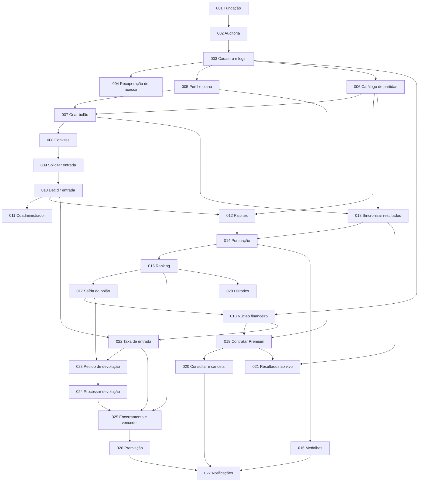

# Mapa de Specs — Palpite League

- **Status:** proposta, aguardando aprovação humana.
- **Etapa:** Spec-Driven Development, decomposição do projeto em Specs (prompt principal).
- **Escopo deste documento:** somente o índice ordenado de Specs, as análises que o sustentam e as questões em aberto. Nenhuma Spec individual, código, banco de dados, endpoint ou escolha tecnológica nova foi produzida.
- **Fonte de verdade:** artefatos de `docs/` (visão, personas, RF, RB, RNF, modelo de domínio, casos de uso, drivers, ADRs, arquitetura consolidada e validação do Mercado Pago).

---

## 1. Análise da baseline

### 1.1 Principais comportamentos identificados

1. Identidade e acesso: cadastro, autenticação, recuperação de acesso, perfil e plano (RF01–RF05).
2. Planos e assinatura Premium: contratação, consulta, cancelamento, expiração e efeitos no limite de criação (RF06–RF08; RB01–RB12, RB55, RB56).
3. Catálogo esportivo: times, rodadas e partidas obtidos de uma API externa (UC01 passo 3; ADR-0002).
4. Criação e configuração de bolão com regras imutáveis e limite por plano (RF09–RF11, RF18, RF38; UC01).
5. Convite, solicitação de entrada, aceite das regras, entrada tardia, aprovação e confirmação da participação (RF12–RF16; UC03).
6. Papéis por bolão: administrador, coadministrador e participante (RF17; UC08).
7. Palpites com prazo e exclusividade de modalidade (RF20–RF22; UC04).
8. Apuração: resultado oficial via API, pontuação, ranking, melhor da rodada e medalhas (RF23–RF29; UC05).
9. Resultados ao vivo para bolões criados por usuários Premium (RF24; RB06, RB31, RB58).
10. Operações financeiras de teste: taxa de entrada, devolução, premiação e registro das movimentações (RF30, RF31, RF33, RF34, RF37, RF19; UC03, UC06, UC07).
11. Saída do bolão (RF32; UC06).
12. Encerramento, vencedor e premiação (RF35–RF37; UC07).
13. Notificações e histórico (RF39, RF40).

### 1.2 Dependências entre comportamentos

### 1.3 Regras de negócio e invariantes associados (principais)

- Regras do bolão imutáveis após a criação: taxa, premiação, período, partidas e desempate (RB15, RB23, RB43, RB51).
- Um único tipo de palpite por partida e no máximo um palpite por participante e partida (RB25, RB26; UC04 pós-condição).
- Palpite só até o início da partida (RB27, RB28, RF22).
- Resultado oficial somente pela API esportiva, nunca manual (RB29, RB30, RB60, RF25).
- Pontuação fixa: 2 pontos por resultado, 5 por placar exato, 0 por erro (RB34–RB37).
- Limites de criação: 1 bolão no plano Gratuito e 10 no Premium; participação sem limite (RB02, RB03, RB05, RB57).
- Medalha para todos os empatados na maior pontuação da rodada, sem efeito em pontos ou prêmio (RB39–RB41).
- Saída sem devolução automática; devolução só após autorização administrativa e confirmação do provedor; remoção unilateral proibida (RB44–RB48).
- Participação com taxa só se confirma após aprovação e pagamento confirmado (RB18, RB22, RB62).
- Plano Premium só ativa após confirmação válida do pagamento (RB55).
- Toda movimentação financeira é registrada e vinculada a usuário e operação (RB53, RB54).
- Autorização e regras de domínio validadas no backend (ADR-0005; RNF12).

### 1.4 Requisitos não funcionais transversais

Associados às Specs em que se aplicam, sem Specs próprias: RNF01, RNF02, RNF03, RNF04, RNF05, RNF06, RNF07, RNF09, RNF11, RNF12, RNF13, RNF14, RNF16, RNF18, RNF20. RNF08, RNF10, RNF15 e RNF17 são específicos de integrações e aparecem nas Specs correspondentes.

### 1.5 Restrições e decisões arquiteturais já tomadas

- ADR-0001 (Aceito): backend como monólito modular.
- ADR-0002 (Aceito para o protótipo, prova técnica pendente): API-Football isolada em adaptador; testes com respostas simuladas.
- ADR-0003 (Aceito, validação sandbox pendente): Mercado Pago em teste; Assinaturas para Premium e Checkout Pro para taxa; devolução e premiação validadas por operação; simulador permitido e sempre identificado; sem repetição automática de cobrança, reembolso ou repasse.
- ADR-0004 (Aceito): React com JavaScript e Vite, Node.js com Express, SQLite com SQL direto e `better-sqlite3`; hospedagem fora do escopo.
- ADR-0005 (Aceito): invariantes validadas no backend.
- Sem dinheiro real, sem credenciais de produção, sem segredos no repositório (RNF15).
- As validações práticas que envolvam API esportiva, sandbox financeiro ou carga devem ser confirmadas com a equipe antes de executar (arquitetura consolidada §4.11 e §6.11).

### 1.6 Inconsistências, lacunas e decisões em aberto

Registradas na seção 4 como `OPEN-XX`. Nenhuma foi resolvida silenciosamente.

---

## 2. Mapa ordenado de Specs

Convenções: `—` significa que a baseline não traz item correspondente. Specs marcadas como **técnica** têm sua necessidade demonstrada nos artefatos de arquitetura (regra 3 do prompt) e entregam comportamento verificável.

### Índice

| ID | Nome | Depende de |
| --- | --- | --- |
| SPEC-001 | Fundação técnica do monólito modular (técnica) | — |
| SPEC-002 | Trilha de auditoria (técnica) | 001 |
| SPEC-003 | Cadastro e autenticação de usuário | 001, 002 |
| SPEC-004 | Recuperação de acesso | 003 |
| SPEC-005 | Perfil do usuário e consulta do plano | 003 |
| SPEC-006 | Consulta de times, rodadas e partidas via adaptador esportivo | 001, 003 |
| SPEC-007 | Criação, configuração e consulta das regras do bolão | 002, 003, 005, 006 |
| SPEC-008 | Convites para o bolão | 007 |
| SPEC-009 | Solicitação de entrada, aceite das regras e entrada tardia | 008 |
| SPEC-010 | Decisão administrativa de entrada e confirmação sem taxa | 009 |
| SPEC-011 | Promoção a coadministrador | 010 |
| SPEC-012 | Realização e alteração de palpite dentro do prazo | 006, 007, 010 |
| SPEC-013 | Sincronização de resultados oficiais | 001, 006, 007 |
| SPEC-014 | Cálculo automático da pontuação | 012, 013 |
| SPEC-015 | Ranking acumulado, desempate e consulta de desempenho | 007, 010, 014 |
| SPEC-016 | Melhor jogador da rodada e medalhas | 013, 014 |
| SPEC-017 | Saída voluntária do bolão | 010, 012, 015 |
| SPEC-018 | Núcleo financeiro de teste (técnica) | 001, 002, 003 |
| SPEC-019 | Contratação do Premium e ativação dos recursos | 005, 018 |
| SPEC-020 | Consulta e cancelamento da assinatura, expiração e downgrade | 007, 019 |
| SPEC-021 | Resultados ao vivo em bolões Premium | 007, 013, 019 |
| SPEC-022 | Pagamento da taxa de entrada e confirmação financeira da participação | 010, 018 |
| SPEC-023 | Solicitação e decisão administrativa de devolução | 017, 018, 022 |
| SPEC-024 | Processamento da devolução no provedor de teste | 018, 023 |
| SPEC-025 | Encerramento automático e determinação do vencedor | 015, 017, 022, 024 |
| SPEC-026 | Solicitação e processamento da premiação | 018, 025 |
| SPEC-027 | Notificações de eventos | 010, 013, 016, 019, 020, 026 |
| SPEC-028 | Histórico do bolão | 012, 013, 014, 015 |

---

### SPEC-001 — Fundação técnica do monólito modular (técnica)

- **Objetivo:** disponibilizar a estrutura executável localmente do monólito modular, com os módulos de responsabilidade previstos, acesso à persistência com transações, registro técnico de eventos e uma suíte de testes que roda sem credenciais externas.
- **Valor entregue:** base verificável (a aplicação sobe, responde e persiste de forma atômica) sobre a qual todas as demais Specs são implementadas. Não contém regra de negócio.
- **RF:** — (habilitadora de todos).
- **RB:** —.
- **RNF:** RNF02, RNF05, RNF18, RNF19, RNF20.
- **Caso de uso/fluxo:** — (transversal; ver arquitetura consolidada §14.1–§14.3).
- **Entidades:** nenhuma de domínio.
- **Drivers:** DA-01, DA-05, DA-06.
- **ADRs:** ADR-0001, ADR-0004, ADR-0005.
- **Dependências:** nenhuma.
- **Justificativa da posição:** todas as Specs exigem módulos, persistência transacional, testes independentes de provedores e log técnico; a necessidade está demonstrada em ADR-0001, ADR-0004 e RNF19.
- **Questões em aberto relacionadas:** OPEN-03.

### SPEC-002 — Trilha de auditoria (técnica)

- **Objetivo:** registrar operações auditáveis com ator, ação, objeto afetado, data e hora em UTC e resultado, identificando o sistema como ator nas ações automáticas, sem armazenar segredos.
- **Valor entregue:** evidência consultável de quem fez o quê, reutilizada por cadastro, autenticação, aceite, palpite, decisões administrativas, sincronizações e movimentações.
- **RF:** — (habilitadora; RF31 e RF40 dependem de registros dessa natureza).
- **RB:** RB65 (registro do aceite) e RB53 (registro das movimentações) como consumidores.
- **RNF:** RNF04, RNF16, RNF01, RNF20.
- **Caso de uso/fluxo:** — (transversal; arquitetura consolidada §4.3 e §7.7).
- **Entidades:** registro de auditoria (não existe no modelo conceitual; ver OPEN-31).
- **Drivers:** DA-03, DA-04.
- **ADRs:** ADR-0001, ADR-0005.
- **Dependências:** SPEC-001.
- **Justificativa da posição:** cadastro e autenticação já são operações auditáveis (arquitetura consolidada §4.3); a trilha precisa existir antes das Specs que a utilizam.
- **Questões em aberto relacionadas:** OPEN-31.

### SPEC-003 — Cadastro e autenticação de usuário

- **Objetivo:** permitir que um visitante crie uma conta e que um usuário com credenciais válidas seja autenticado.
- **Valor entregue:** acesso identificado ao sistema, pré-condição de todos os casos de uso.
- **RF:** RF01, RF02.
- **RB:** RB01 e RB02 (plano Gratuito como plano inicial, a confirmar).
- **RNF:** RNF01, RNF06, RNF11, RNF13, RNF14.
- **Caso de uso/fluxo:** pré-condição de UC01–UC08 (usuário autenticado).
- **Entidades:** Usuario (Carteira, se criada no cadastro; ver OPEN-22).
- **Drivers:** DA-04, DA-06.
- **ADRs:** ADR-0001, ADR-0004, ADR-0005.
- **Dependências:** SPEC-001, SPEC-002.
- **Justificativa da posição:** nenhuma funcionalidade protegida pode ser especificada ou testada sem identidade.
- **Questões em aberto relacionadas:** OPEN-05, OPEN-06, OPEN-09, OPEN-22.

### SPEC-004 — Recuperação de acesso

- **Objetivo:** iniciar a redefinição de senha quando o usuário solicitar a recuperação de acesso.
- **Valor entregue:** o usuário que perdeu a senha volta a acessar a conta.
- **RF:** RF03.
- **RB:** —.
- **RNF:** RNF01, RNF20.
- **Caso de uso/fluxo:** — (RF03 não possui caso de uso).
- **Entidades:** Usuario.
- **Drivers:** DA-04.
- **ADRs:** ADR-0004, ADR-0005.
- **Dependências:** SPEC-003.
- **Justificativa da posição:** exige a conta existente. Fica separada porque depende de decisão ainda em aberto sobre o mecanismo e o canal de recuperação.
- **Questões em aberto relacionadas:** OPEN-07.

### SPEC-005 — Perfil do usuário e consulta do plano

- **Objetivo:** permitir visualizar e alterar dados pessoais permitidos e consultar plano atual, status e recursos disponíveis.
- **Valor entregue:** o usuário gerencia seus dados e sabe o que seu plano permite (limite de bolões e recurso ao vivo).
- **RF:** RF04, RF05.
- **RB:** RB01, RB02, RB03, RB05, RB06.
- **RNF:** RNF01, RNF11.
- **Caso de uso/fluxo:** UC02 (parte de consulta do plano, RF05).
- **Entidades:** Usuario.
- **Drivers:** DA-04.
- **ADRs:** ADR-0005.
- **Dependências:** SPEC-003.
- **Justificativa da posição:** estabelece o atributo de plano que a criação de bolão (SPEC-007) consulta. Nesta Spec só o plano Gratuito é alcançável; o Premium passa a existir na SPEC-019.
- **Questões em aberto relacionadas:** OPEN-05, OPEN-09.

### SPEC-006 — Consulta de times, rodadas e partidas via adaptador esportivo

- **Objetivo:** disponibilizar ao sistema o catálogo de times, rodadas e partidas por meio de um adaptador isolado da API esportiva, com implementação simulada para desenvolvimento e testes.
- **Valor entregue:** o administrador passa a ver partidas e rodadas reais para selecionar; o sistema não inventa partidas quando a fonte está indisponível.
- **RF:** RF18 (pré-requisito da seleção); RF23 compartilha o mesmo adaptador (SPEC-013).
- **RB:** RB24, RB29.
- **RNF:** RNF08, RNF18, RNF19, RNF20, RNF01.
- **Caso de uso/fluxo:** UC01 passo 3 e exceção A2.
- **Entidades:** Time, Rodada, Partida.
- **Drivers:** DA-02, DA-05.
- **ADRs:** ADR-0002, ADR-0001.
- **Dependências:** SPEC-001, SPEC-003.
- **Justificativa da posição:** a criação de bolão exige partidas e rodadas para seleção. A integração real fica condicionada à prova técnica do ADR-0002; até lá, a Spec cobre o contrato do adaptador e o uso simulado.
- **Questões em aberto relacionadas:** OPEN-01, OPEN-02, OPEN-09, OPEN-37.

### SPEC-007 — Criação, configuração e consulta das regras do bolão

- **Objetivo:** permitir que um usuário dentro do limite do plano crie um bolão com nome, período, taxa de entrada, modelo de premiação, partidas e critério de desempate, registrando regras imutáveis, e que membros consultem essas regras.
- **Valor entregue:** o bolão existe com regras fixas e rastreáveis, e o criador já é administrador e participante.
- **RF:** RF09, RF10, RF11 (visão dos membros), RF18 (seleção individual ou por rodada, na criação), RF38.
- **RB:** RB02, RB03, RB05, RB06 e RB58 (marcação do recurso ao vivo conforme o plano do criador), RB08, RB12, RB13, RB14, RB15, RB23, RB24, RB51 (definição), RB57, RB64.
- **RNF:** RNF01, RNF02, RNF04, RNF11, RNF12, RNF18.
- **Caso de uso/fluxo:** UC01 passos 1–7 e exceções A1, A3.
- **Entidades:** Bolao, Participacao (criador), Usuario, Rodada, Partida.
- **Drivers:** DA-01, DA-04.
- **ADRs:** ADR-0001, ADR-0005.
- **Dependências:** SPEC-002, SPEC-003, SPEC-005, SPEC-006.
- **Justificativa da posição:** primeiro agregado central do domínio. Todo o restante (convites, palpites, ranking, finanças do bolão) depende de o bolão existir com regras imutáveis.
- **Questões em aberto relacionadas:** OPEN-08, OPEN-09, OPEN-10, OPEN-11, OPEN-12, OPEN-13, OPEN-14, OPEN-15, OPEN-19, OPEN-38.

### SPEC-008 — Convites para o bolão

- **Objetivo:** permitir que quem administra o bolão disponibilize convites por link ou mecanismo interno.
- **Valor entregue:** o administrador consegue trazer convidados, condição para qualquer entrada em bolão privado.
- **RF:** RF12.
- **RB:** RB17.
- **RNF:** RNF01, RNF04, RNF12.
- **Caso de uso/fluxo:** UC01 passos 8–9.
- **Entidades:** Convite, Bolao, Usuario.
- **Drivers:** DA-04.
- **ADRs:** ADR-0005.
- **Dependências:** SPEC-007.
- **Justificativa da posição:** exige o bolão criado e precede qualquer solicitação de entrada. O papel coadministrador já é aceito como papel autorizado, mas só passa a ser atribuível na SPEC-011.
- **Questões em aberto relacionadas:** OPEN-08, OPEN-09, OPEN-16.

### SPEC-009 — Solicitação de entrada, aceite das regras e entrada tardia

- **Objetivo:** permitir que um usuário com convite válido consulte as regras, aceite-as, confirme a ciência da entrada tardia quando aplicável e registre sua solicitação de participação.
- **Valor entregue:** a solicitação de entrada nasce com aceite registrado e com ciência das partidas já perdidas.
- **RF:** RF11 (visão do convidado), RF13, RF15, RF16.
- **RB:** RB05, RB17, RB19, RB20, RB21, RB61, RB65.
- **RNF:** RNF01, RNF02, RNF04, RNF11, RNF13, RNF14, RNF16, RNF18.
- **Caso de uso/fluxo:** UC03 passos 1–5 e exceções A1, A2, A3.
- **Entidades:** Convite, Participacao, Bolao, Usuario, Partida.
- **Drivers:** DA-01, DA-04, DA-06.
- **ADRs:** ADR-0005.
- **Dependências:** SPEC-008.
- **Justificativa da posição:** primeira etapa do fluxo de entrada, usada pela decisão administrativa (SPEC-010) e pela taxa (SPEC-022).
- **Questões em aberto relacionadas:** OPEN-09, OPEN-10, OPEN-16, OPEN-17, OPEN-19.

### SPEC-010 — Decisão administrativa de entrada e confirmação sem taxa

- **Objetivo:** permitir que administrador ou coadministrador aprove ou rejeite solicitações de entrada e que a participação em bolão sem taxa seja confirmada após a aprovação.
- **Valor entregue:** participantes passam a existir de fato no bolão; em bolão com taxa, a participação aprovada permanece não confirmada até a SPEC-022.
- **RF:** RF14.
- **RB:** RB18, RB59.
- **RNF:** RNF01, RNF04, RNF12, RNF16.
- **Caso de uso/fluxo:** UC03 passo 6 e exceções A4, A5.
- **Entidades:** Participacao.
- **Drivers:** DA-01, DA-04.
- **ADRs:** ADR-0005.
- **Dependências:** SPEC-009.
- **Justificativa da posição:** produz participantes confirmados, pré-condição de promoção, palpites e todo o restante.
- **Questões em aberto relacionadas:** OPEN-08, OPEN-09, OPEN-38.

### SPEC-011 — Promoção a coadministrador

- **Objetivo:** permitir que o administrador atribua o papel de coadministrador a um participante do mesmo bolão.
- **Valor entregue:** a administração do bolão pode ser compartilhada com as permissões do papel.
- **RF:** RF17.
- **RB:** RB16, RB59.
- **RNF:** RNF04, RNF12, RNF16.
- **Caso de uso/fluxo:** UC08, incluindo A1 e A2.
- **Entidades:** Participacao.
- **Drivers:** DA-04.
- **ADRs:** ADR-0005.
- **Dependências:** SPEC-010.
- **Justificativa da posição:** exige participante confirmado como alvo da promoção (UC08 A2).
- **Questões em aberto relacionadas:** OPEN-08, OPEN-09.

### SPEC-012 — Realização e alteração de palpite dentro do prazo

- **Objetivo:** permitir que um participante confirmado registre ou altere um palpite de resultado ou de placar exato até o início da partida, e bloquear a operação depois disso.
- **Valor entregue:** o participante palpita nas partidas do bolão com garantia de prazo e de exclusividade de modalidade.
- **RF:** RF20, RF21, RF22.
- **RB:** RB21, RB25, RB26, RB27, RB28.
- **RNF:** RNF01, RNF02, RNF03, RNF06, RNF07, RNF09, RNF13, RNF14, RNF16, RNF18.
- **Caso de uso/fluxo:** UC04 (fluxo principal e A1–A3).
- **Entidades:** Palpite, Participacao, Partida, Bolao.
- **Drivers:** DA-01.
- **ADRs:** ADR-0005.
- **Dependências:** SPEC-006, SPEC-007, SPEC-010.
- **Justificativa da posição:** primeiro núcleo competitivo, depende de partidas com horário, de bolão com partidas selecionadas e de participante confirmado.
- **Questões em aberto relacionadas:** OPEN-02, OPEN-17, OPEN-18, OPEN-37.

### SPEC-013 — Sincronização de resultados oficiais

- **Objetivo:** consultar a API esportiva, validar e registrar estado e resultado oficial das partidas, preservar dados em caso de falha, permitir nova sincronização e impedir inserção ou edição manual do resultado.
- **Valor entregue:** resultados oficiais confiáveis e disponíveis após o encerramento das partidas, sem intervenção humana.
- **RF:** RF23, RF25.
- **RB:** RB07, RB29, RB30, RB32, RB60.
- **RNF:** RNF02, RNF04, RNF08, RNF17, RNF18, RNF20.
- **Caso de uso/fluxo:** UC05 passos 1–3 e exceções A1, A2, A3.
- **Entidades:** Partida, Bolao (partidas selecionadas).
- **Drivers:** DA-02.
- **ADRs:** ADR-0002, ADR-0001.
- **Dependências:** SPEC-001, SPEC-006, SPEC-007.
- **Justificativa da posição:** precede o cálculo de pontos. A integração real depende da prova técnica pendente do ADR-0002.
- **Questões em aberto relacionadas:** OPEN-01, OPEN-02, OPEN-03, OPEN-04, OPEN-09.

### SPEC-014 — Cálculo automático da pontuação

- **Objetivo:** comparar o resultado oficial com os palpites e calcular os pontos (2 por resultado, 5 por placar exato, 0 por erro), de forma repetível e sem duplicar pontuação.
- **Valor entregue:** o participante não precisa calcular pontos manualmente.
- **RF:** RF26.
- **RB:** RB33, RB34, RB35, RB36, RB37.
- **RNF:** RNF02, RNF03, RNF17, RNF18.
- **Caso de uso/fluxo:** UC05 passos 4–5.
- **Entidades:** Palpite (pontos ganhos), Partida, Participacao.
- **Drivers:** DA-01, DA-02.
- **ADRs:** ADR-0005, ADR-0002.
- **Dependências:** SPEC-012, SPEC-013.
- **Justificativa da posição:** exige palpites registrados e resultados oficiais.
- **Questões em aberto relacionadas:** OPEN-02, OPEN-04.

### SPEC-015 — Ranking acumulado, desempate e consulta de desempenho

- **Objetivo:** atualizar a pontuação acumulada e a classificação do bolão aplicando o critério de desempate definido na criação, e permitir que participantes acompanhem colocação, pontos e desempenho por rodada.
- **Valor entregue:** o participante acompanha sua posição no bolão.
- **RF:** RF27.
- **RB:** RB38, RB42, RB43.
- **RNF:** RNF03, RNF06, RNF07, RNF11, RNF13, RNF14, RNF18.
- **Caso de uso/fluxo:** UC05 passo 6.
- **Entidades:** Participacao (pontuação total), Bolao (critério de desempate), Palpite.
- **Drivers:** DA-01.
- **ADRs:** ADR-0005.
- **Dependências:** SPEC-007, SPEC-010, SPEC-014.
- **Justificativa da posição:** consome pontos calculados. A consulta ao ranking não possui RF explícito, apesar de aparecer na visão, nas personas e nos RNF13/RNF14 (ver OPEN-34).
- **Questões em aberto relacionadas:** OPEN-04, OPEN-14, OPEN-18, OPEN-21, OPEN-34.

### SPEC-016 — Melhor jogador da rodada e medalhas

- **Objetivo:** identificar todos os participantes empatados na maior pontuação de uma rodada encerrada e associar a cada um uma medalha visual dentro do bolão.
- **Valor entregue:** incentivo competitivo por rodada, sem efeito na pontuação ou na premiação.
- **RF:** RF28, RF29.
- **RB:** RB39, RB40, RB41.
- **RNF:** RNF02, RNF03, RNF18.
- **Caso de uso/fluxo:** UC05 passo 7 e exceção A4.
- **Entidades:** Medalha, Rodada, Participacao, Bolao.
- **Drivers:** DA-01.
- **ADRs:** ADR-0005.
- **Dependências:** SPEC-013, SPEC-014.
- **Justificativa da posição:** exige pontuação por partida e estado de encerramento da rodada.
- **Questões em aberto relacionadas:** OPEN-02, OPEN-04, OPEN-20.

### SPEC-017 — Saída voluntária do bolão

- **Objetivo:** permitir que um participante confirme sua saída a qualquer momento, encerrando sua participação nas atividades futuras e informando que não há devolução automática, sem permitir remoção unilateral por administração.
- **Valor entregue:** o participante controla sua permanência, com consequências explícitas.
- **RF:** RF32.
- **RB:** RB44, RB45, RB48.
- **RNF:** RNF02, RNF04, RNF12, RNF16.
- **Caso de uso/fluxo:** UC06 fluxo de saída e exceção A1.
- **Entidades:** Participacao.
- **Drivers:** DA-01, DA-04.
- **ADRs:** ADR-0005.
- **Dependências:** SPEC-010, SPEC-012, SPEC-015.
- **Justificativa da posição:** o efeito de "encerrar participação nas próximas atividades" só é verificável com palpites (SPEC-012) e ranking (SPEC-015) já existentes.
- **Questões em aberto relacionadas:** OPEN-09, OPEN-21.

### SPEC-018 — Núcleo financeiro de teste (técnica)

- **Objetivo:** registrar movimentações financeiras de teste de forma auditável e idempotente e isolar o provedor de pagamentos atrás de um adaptador, com simulador sempre identificado como tal, estados pendente, confirmado e recusado, e consulta do estado antes de qualquer nova tentativa.
- **Valor entregue:** base única e segura para assinatura, taxa, devolução e premiação, sem duplicidade e sem apresentar simulação como confirmação do provedor.
- **RF:** RF31 (registro da movimentação; as Specs financeiras seguintes o estendem).
- **RB:** RB53, RB54.
- **RNF:** RNF01, RNF02, RNF04, RNF09, RNF10, RNF11, RNF15, RNF16, RNF18, RNF20.
- **Caso de uso/fluxo:** transversal a UC02, UC03, UC06 e UC07 (seção "Escopo de pagamentos" de `casos-de-uso.md`).
- **Entidades:** MovimentacaoFinanceira, Carteira (ver OPEN-22), Usuario; referências a Bolao e Assinatura.
- **Drivers:** DA-03, DA-05.
- **ADRs:** ADR-0003, ADR-0004, ADR-0001.
- **Dependências:** SPEC-001, SPEC-002, SPEC-003.
- **Justificativa da posição:** quatro Specs posteriores (019, 022, 024, 026) dependem do mesmo registro, da mesma idempotência e do mesmo adaptador; a necessidade está em ADR-0003, RNF09, RNF10 e RNF15. Fica depois do núcleo competitivo porque o ranking e os palpites não dependem de dinheiro.
- **Questões em aberto relacionadas:** OPEN-09, OPEN-22, OPEN-26, OPEN-33, OPEN-36.

### SPEC-019 — Contratação do Premium e ativação dos recursos

- **Objetivo:** permitir que o usuário solicite o Premium, acompanhe a operação pendente e tenha os recursos ativados somente após confirmação válida do pagamento.
- **Valor entregue:** limite de 10 bolões e recurso ao vivo disponíveis para quem assina.
- **RF:** RF06 (com registro conforme RF31).
- **RB:** RB01, RB03, RB04, RB09, RB55.
- **RNF:** RNF01, RNF04, RNF09, RNF10, RNF15, RNF16.
- **Caso de uso/fluxo:** UC02 fluxo de contratação e exceções A1, A2, A3, A5.
- **Entidades:** Assinatura, Usuario, MovimentacaoFinanceira.
- **Drivers:** DA-03.
- **ADRs:** ADR-0003, ADR-0004.
- **Dependências:** SPEC-005, SPEC-018.
- **Justificativa da posição:** exige o núcleo financeiro e o atributo de plano; destrava o limite de 10 bolões e o recurso ao vivo (SPEC-021).
- **Questões em aberto relacionadas:** OPEN-09, OPEN-23, OPEN-26, OPEN-36.

### SPEC-020 — Consulta e cancelamento da assinatura, expiração e downgrade

- **Objetivo:** permitir consultar a assinatura, solicitar o cancelamento com estado pendente até confirmação e aplicar o retorno ao plano Gratuito (novas criações) preservando os bolões existentes.
- **Valor entregue:** transparência sobre a assinatura e transição segura para o plano Gratuito.
- **RF:** RF07, RF08 (com registro conforme RF31).
- **RB:** RB09, RB10, RB11, RB12, RB56.
- **RNF:** RNF04, RNF09, RNF11, RNF15, RNF16.
- **Caso de uso/fluxo:** UC02 fluxos de consulta e cancelamento e exceções A4, A5.
- **Entidades:** Assinatura, Usuario, Bolao (preservado), MovimentacaoFinanceira.
- **Drivers:** DA-03, DA-01.
- **ADRs:** ADR-0003.
- **Dependências:** SPEC-007, SPEC-019.
- **Justificativa da posição:** exige assinatura ativa e a regra de limite de criação (SPEC-007) para verificar RB12.
- **Questões em aberto relacionadas:** OPEN-09, OPEN-23, OPEN-24, OPEN-26, OPEN-36.

### SPEC-021 — Resultados ao vivo em bolões Premium

- **Objetivo:** atualizar periodicamente as informações das partidas durante sua realização, somente nos bolões com o recurso habilitado, sem tratar dados parciais como resultado oficial.
- **Valor entregue:** acompanhamento em tempo real, diferencial do plano Premium.
- **RF:** RF24.
- **RB:** RB06, RB31, RB58 (RB07 e RB32 para bolões sem o recurso).
- **RNF:** RNF08, RNF18, RNF20.
- **Caso de uso/fluxo:** UC05 (extensão do passo 3; A3 para bolões sem o recurso).
- **Entidades:** Bolao (recurso ao vivo), Partida.
- **Drivers:** DA-02.
- **ADRs:** ADR-0002.
- **Dependências:** SPEC-007, SPEC-013, SPEC-019.
- **Justificativa da posição:** estende a sincronização e só é demonstrável de ponta a ponta após existir bolão criado por Premium.
- **Questões em aberto relacionadas:** OPEN-01, OPEN-03, OPEN-24, OPEN-25.

### SPEC-022 — Pagamento da taxa de entrada e confirmação financeira da participação

- **Objetivo:** iniciar a cobrança da taxa de entrada após a aprovação, manter a participação não confirmada enquanto o pagamento estiver pendente, recusado ou indisponível e confirmá-la somente após confirmação verificável.
- **Valor entregue:** participação financeira confirmada, sem cobranças duplicadas.
- **RF:** RF30 (com registro conforme RF31).
- **RB:** RB08, RB22, RB23, RB62.
- **RNF:** RNF01, RNF02, RNF04, RNF09, RNF10, RNF13, RNF14, RNF15, RNF16.
- **Caso de uso/fluxo:** UC03 passos 7–9 e exceções A6, A7, A8.
- **Entidades:** Participacao (pagamento confirmado), MovimentacaoFinanceira, Bolao (taxa de entrada).
- **Drivers:** DA-03.
- **ADRs:** ADR-0003, ADR-0004.
- **Dependências:** SPEC-010, SPEC-018.
- **Justificativa da posição:** completa o fluxo de entrada (UC03) para bolões com taxa; precede devolução (que exige valor pago) e premiação.
- **Questões em aberto relacionadas:** OPEN-09, OPEN-15, OPEN-17, OPEN-26, OPEN-36, OPEN-38.

### SPEC-023 — Solicitação e decisão administrativa de devolução

- **Objetivo:** permitir que quem saiu do bolão solicite formalmente a devolução de valor elegível e que administrador ou coadministrador aprove ou rejeite, registrando a autorização.
- **Valor entregue:** fluxo formal e auditável de pedido e decisão, sem devolução automática.
- **RF:** RF19, RF33, RF34 (registro da autorização ou rejeição).
- **RB:** RB45, RB46, RB47, RB59.
- **RNF:** RNF02, RNF04, RNF11, RNF12, RNF16.
- **Caso de uso/fluxo:** UC06 fluxo de devolução passos 1–3 e exceções A2, A3.
- **Entidades:** SolicitacaoDevolucao, Participacao, MovimentacaoFinanceira.
- **Drivers:** DA-03, DA-04.
- **ADRs:** ADR-0003, ADR-0005.
- **Dependências:** SPEC-017, SPEC-018, SPEC-022.
- **Justificativa da posição:** exige saída registrada (SPEC-017) e taxa efetivamente paga (SPEC-022).
- **Questões em aberto relacionadas:** OPEN-08, OPEN-09, OPEN-22, OPEN-28, OPEN-30.

### SPEC-024 — Processamento da devolução no provedor de teste

- **Objetivo:** encaminhar ao provedor de teste a devolução aprovada, manter o estado pendente até confirmação verificável, registrar recusa ou conclusão e consultar o estado antes de qualquer nova tentativa.
- **Valor entregue:** devolução aprovada concluída com rastreabilidade, ou claramente pendente ou recusada.
- **RF:** RF34 (início do processo de devolução financeira), RF31.
- **RB:** RB47, RB53, RB54.
- **RNF:** RNF02, RNF04, RNF09, RNF10, RNF15, RNF16.
- **Caso de uso/fluxo:** UC06 passos 4–6 e exceções A4, A5, A6.
- **Entidades:** SolicitacaoDevolucao, MovimentacaoFinanceira, Carteira (ver OPEN-22).
- **Drivers:** DA-03.
- **ADRs:** ADR-0003.
- **Dependências:** SPEC-018, SPEC-023.
- **Justificativa da posição:** separada da decisão administrativa porque a compatibilidade do reembolso com o Checkout Pro ainda não foi confirmada (validação documental do Mercado Pago).
- **Questões em aberto relacionadas:** OPEN-22, OPEN-27, OPEN-28, OPEN-36.

### SPEC-025 — Encerramento automático e determinação do vencedor

- **Objetivo:** encerrar o bolão ao atingir o período final, calcular a classificação final com o critério de desempate e registrar vencedor ou vencedores elegíveis, ou a ausência deles.
- **Valor entregue:** resultado final automático e justo, sem apuração manual.
- **RF:** RF35, RF36.
- **RB:** RB42, RB43, RB49, RB50, RB63.
- **RNF:** RNF02, RNF03, RNF04, RNF18.
- **Caso de uso/fluxo:** UC07 passos 1–3 e exceções A1, A2.
- **Entidades:** Bolao, Participacao, Palpite.
- **Drivers:** DA-01.
- **ADRs:** ADR-0005, ADR-0001.
- **Dependências:** SPEC-015, SPEC-017, SPEC-022, SPEC-024.
- **Justificativa da posição:** a elegibilidade (RB63) depende de saída (SPEC-017) e de pagamento confirmado (SPEC-022). Fica após a devolução porque o montante da premiação pode depender dela (OPEN-13); a dependência de SPEC-024 é uma proposta a validar.
- **Questões em aberto relacionadas:** OPEN-02, OPEN-03, OPEN-04, OPEN-09, OPEN-11, OPEN-13, OPEN-14, OPEN-21.

### SPEC-026 — Solicitação e processamento da premiação

- **Objetivo:** permitir que o vencedor elegível solicite sua parte da premiação, recusar duplicidade e inelegibilidade, manter o estado pendente até confirmação verificável e identificar claramente qualquer simulação.
- **Valor entregue:** fechamento do ciclo do bolão com a premiação definida na criação.
- **RF:** RF37 (com registro conforme RF31).
- **RB:** RB51, RB52, RB53, RB63.
- **RNF:** RNF04, RNF09, RNF10, RNF15, RNF16.
- **Caso de uso/fluxo:** UC07 passos 4–8 e exceções A3–A7.
- **Entidades:** Bolao, Participacao, MovimentacaoFinanceira, Carteira (ver OPEN-22).
- **Drivers:** DA-03.
- **ADRs:** ADR-0003, ADR-0004.
- **Dependências:** SPEC-018, SPEC-025.
- **Justificativa da posição:** exige vencedor determinado e o núcleo financeiro. A integração real depende de validação de sandbox ainda não executada; o simulador, se usado na demonstração, nunca conta como integração atendida.
- **Questões em aberto relacionadas:** OPEN-13, OPEN-22, OPEN-29, OPEN-36.

### SPEC-027 — Notificações de eventos

- **Objetivo:** disponibilizar ao usuário notificações dos eventos relevantes: aprovação de entrada, atualização de resultado, encerramento de rodada, medalha, alteração de assinatura e conclusão de premiação.
- **Valor entregue:** o usuário é avisado sem precisar consultar cada tela.
- **RF:** RF39.
- **RB:** —.
- **RNF:** RNF01, RNF06, RNF11.
- **Caso de uso/fluxo:** — (RF39 não possui caso de uso; os eventos vêm de UC02, UC03, UC05 e UC07).
- **Entidades:** Notificacao, Usuario.
- **Drivers:** DA-04.
- **ADRs:** ADR-0001.
- **Dependências:** SPEC-010, SPEC-013, SPEC-016, SPEC-019, SPEC-020, SPEC-026.
- **Justificativa da posição:** observa estados já estabelecidos pelas Specs que originam cada evento; assim nenhuma Spec anterior depende dela.
- **Questões em aberto relacionadas:** OPEN-32.

### SPEC-028 — Histórico do bolão

- **Objetivo:** apresentar ao participante o histórico de partidas, palpites, pontuações, ranking e resultados registrados durante sua participação.
- **Valor entregue:** consulta consolidada e consistente do que aconteceu no bolão.
- **RF:** RF40.
- **RB:** RB64.
- **RNF:** RNF03, RNF06, RNF07, RNF11, RNF13, RNF14.
- **Caso de uso/fluxo:** UC05 passo 8 (disponibilização dos resultados processados).
- **Entidades:** Participacao, Palpite, Partida, Rodada, Bolao.
- **Drivers:** DA-01, DA-04.
- **ADRs:** ADR-0005.
- **Dependências:** SPEC-012, SPEC-013, SPEC-014, SPEC-015.
- **Justificativa da posição:** visão de leitura sobre dados produzidos pelas Specs de palpite, resultado, pontuação e ranking.
- **Questões em aberto relacionadas:** OPEN-18, OPEN-34.

---

## 3. Cobertura dos requisitos

### 3.1 Requisitos funcionais

| RF | Spec | RF | Spec | RF | Spec | RF | Spec |
| --- | --- | --- | --- | --- | --- | --- | --- |
| RF01 | 003 | RF11 | 007, 009 | RF21 | 012 | RF31 | 018 (+019, 020, 022, 024, 026) |
| RF02 | 003 | RF12 | 008 | RF22 | 012 | RF32 | 017 |
| RF03 | 004 | RF13 | 009 | RF23 | 013 (+006) | RF33 | 023 |
| RF04 | 005 | RF14 | 010 | RF24 | 021 | RF34 | 023, 024 |
| RF05 | 005 | RF15 | 009 | RF25 | 013 | RF35 | 025 |
| RF06 | 019 | RF16 | 009 | RF26 | 014 | RF36 | 025 |
| RF07 | 020 | RF17 | 011 | RF27 | 015 | RF37 | 026 |
| RF08 | 020 | RF18 | 007 (+006) | RF28 | 016 | RF38 | 007 |
| RF09 | 007 | RF19 | 023 | RF29 | 016 | RF39 | 027 |
| RF10 | 007 | RF20 | 012 | RF30 | 022 | RF40 | 028 |

### 3.2 Regras de negócio

RB01 → 003, 005, 019 · RB02 → 005, 007 · RB03 → 005, 007, 019 · RB04 → 019 · RB05 → 005, 007, 009 · RB06 → 005, 007, 021 · RB07 → 013, 021 · RB08 → 007, 022 · RB09 → 019, 020 · RB10, RB11, RB12 → 020 (RB12 também 007) · RB13, RB14, RB15 → 007 · RB16 → 011 · RB17 → 008, 009 · RB18 → 010 · RB19, RB20 → 009 · RB21 → 009, 012 · RB22 → 022 · RB23 → 007, 022 · RB24 → 006, 007 · RB25–RB28 → 012 · RB29 → 006, 013 · RB30 → 013 · RB31 → 021 · RB32 → 013, 021 · RB33–RB37 → 014 · RB38 → 015 · RB39–RB41 → 016 · RB42, RB43 → 015, 025 · RB44 → 017 · RB45 → 017, 023 · RB46, RB47 → 023 (RB47 também 024) · RB48 → 017 · RB49, RB50 → 025 · RB51 → 007, 026 · RB52 → 026 · RB53, RB54 → 018 (+024, 026) · RB55 → 019 · RB56 → 020 · RB57 → 007 · RB58 → 007, 021 · RB59 → 010, 011, 023 · RB60 → 013 · RB61 → 009 · RB62 → 022 · RB63 → 025, 026 · RB64 → 007, 028 · RB65 → 002, 009.

### 3.3 Requisitos não funcionais

Cada RNF aparece nas Specs em que é verificável (campo **RNF** de cada Spec). RNF08 e RNF17 concentram-se nas Specs 006, 013, 014 e 021. RNF13 e RNF14 aplicam-se aos fluxos de cadastro/autenticação, entrada em bolão, palpite e ranking (Specs 003, 009, 012, 015, 022, 028). Nenhum RNF virou Spec independente.

---

## 4. Questões em aberto

Formato do prompt: `OPEN-XX - decisão necessária: descrição`. Cada item cita a origem da lacuna ou da inconsistência e as Specs afetadas.

### Integrações e dados esportivos

- **OPEN-01 - decisão necessária:** executar e aprovar a prova técnica da API-Football (cobertura da Série A, temporadas necessárias, status e placar, frequência de atualização, cotas, custos e termos) ou trocar de fornecedor. Origem: ADR-0002 (prova pendente), `adr/README.md`. Afeta: 006, 013, 021.
- **OPEN-02 - decisão necessária:** definir o tratamento de partidas adiadas, canceladas, suspensas, remarcadas ou com resultado administrativo, e os valores de `StatusPartida`. Impacto sobre palpites já feitos, prazo, pontuação, encerramento de rodada e do bolão. Origem: modelo de domínio (`StatusPartida` sem valores), RB27, RB39, RB49. Afeta: 006, 012, 013, 014, 016, 025.
- **OPEN-03 - decisão necessária:** definir o mecanismo e a frequência do agendamento da sincronização, das atualizações ao vivo e do encerramento automático. UC05 cita "cronjob" e RF24 cita "periodicamente", mas o ADR-0004 não escolhe ferramenta e a frequência depende de OPEN-01. Origem: UC05, RF24, RNF17, ADR-0004. Afeta: 001, 013, 021, 025.
- **OPEN-04 - decisão necessária:** definir a política quando a API corrige um resultado já registrado, depois de pontuação, medalhas, ranking ou encerramento do bolão. RNF17 prevê recálculo, mas não os efeitos sobre medalhas, vencedor e premiação já processados. Origem: RNF17, RF25, UC07. Afeta: 013, 014, 015, 016, 025, 026.

### Identidade e acesso

- **OPEN-05 - decisão necessária:** definir os dados obrigatórios do cadastro (RF01), os dados pessoais editáveis (RF04), a política de senha, a unicidade de identificadores e os valores de `StatusUsuario`. Origem: RF01, RF04 ("dados obrigatórios", "permitidos pela plataforma"). Afeta: 003, 005.
- **OPEN-06 - decisão necessária:** definir o mecanismo de sessão ou credencial de autenticação e o algoritmo de proteção de senha. RNF01 exige apenas "não texto puro"; o ADR-0004 não decide. Origem: RNF01, ADR-0004. Afeta: 001, 003.
- **OPEN-07 - decisão necessária:** definir o mecanismo e o canal de recuperação de acesso (RF03 fala em "mecanismo configurado") e a validade do código ou link. Não há provedor de envio escolhido. Origem: RF03. Afeta: 004.
- **OPEN-08 - decisão necessária:** documentar a matriz de permissões por papel. RNF12 e RB16 a referenciam ("matriz de permissões do sistema", "permissões definidas pelo sistema"), mas ela não existe nos artefatos. RF12, RF14, RF19 e RF34 citam administrador ou coadministrador; RF17 só o administrador; as demais operações não são especificadas. Afeta: 007, 008, 010, 011, 023.

### Estados e conceitos de bolão

- **OPEN-09 - decisão necessária:** aprovar os valores e as transições das enumerações de estado que o modelo conceitual declara sem detalhar (`StatusBolao`, `StatusParticipacao`, `StatusConvite`, `StatusUsuario`, `StatusAssinatura`, `StatusMovimentacao`, `StatusSolicitacao`, `StatusPartida`). Cada Spec propõe o conjunto mínimo de que precisa, sujeito a aprovação. Afeta: 003, 005, 006, 007, 008, 009, 010, 011, 013, 017, 018, 019, 020, 022, 023, 025.
- **OPEN-10 - decisão necessária:** definir "bolão ativo", "em andamento" e "simultâneos". O limite de criação (RB02, RB03, RB12, RB57) e a entrada tardia (RF16, RB20) dependem dessas definições. Afeta: 007, 009, 020, 025.
- **OPEN-11 - decisão necessária:** definir se a duração é um intervalo de datas ou um conjunto de rodadas e como se relaciona com as partidas selecionadas. O README fala em "duração (rodadas)", RF10 e RB14 em "período de duração" e o modelo usa `dataInicioPeriodo` e `dataFimPeriodo`. Também não está definido se partidas fora do período são permitidas. Afeta: 007, 025.
- **OPEN-12 - decisão necessária:** resolver o conflito sobre a seleção de partidas. RF18 e RB24 permitem ao administrador ou coadministrador selecioná-las, mas RB14, RB15 e a visão tornam as partidas definidas na criação e imutáveis; o coadministrador só existe após a criação. Afeta: 007, 011.
- **OPEN-13 - decisão necessária:** definir o modelo de premiação: tipos admitidos (o atributo é texto livre), origem do montante (soma das taxas ou valor fixo), divisão entre vencedores empatados, moeda, arredondamento e efeito de saídas e devoluções sobre o montante. Origem: RB51, modelo de domínio. Afeta: 007, 024, 025, 026.
- **OPEN-14 - decisão necessária:** definir os critérios de desempate admitidos (`CriterioDesempateTipo` sem valores) e o comportamento quando o critério não separa os empatados (co-vencedores ou posições iguais). Origem: RB42, RF36 ("vencedor ou vencedores"). Afeta: 007, 015, 025.
- **OPEN-15 - decisão necessária:** definir se taxa de entrada igual a zero é válida (RB14 obriga definir a taxa, RF30 e RB22 falam "quando houver"), a moeda, os limites e o prazo de validade de uma cobrança pendente. Afeta: 007, 022.
- **OPEN-16 - decisão necessária:** definir o tipo de convite (link genérico ou nominal; o modelo liga o convite a um usuário convidado, enquanto RF12 fala em link), validade, uso único ou múltiplo e revogação. UC03 A1 cita convite "expirado" sem regra de expiração. Afeta: 008, 009.
- **OPEN-17 - decisão necessária:** definir o instante que caracteriza a "entrada" para fins de entrada tardia (solicitação, aprovação ou confirmação) e alinhar RF16 ("partidas anteriores à sua entrada") com RB21 e UC04 ("prazo já encerrado"), que usam critérios diferentes. Afeta: 009, 010, 012, 022.
- **OPEN-18 - decisão necessária:** definir se participantes veem palpites de outros (antes e depois do início da partida) e se o ranking é visível a quem não participa. Origem: RNF01, RNF11. Afeta: 012, 015, 028.
- **OPEN-19 - decisão necessária:** definir a visibilidade das regras do bolão para convidados que ainda não são membros. RF11 diz "um usuário", RF15 exige apresentar as regras antes da entrada e RNF01 restringe acesso a bolões dos quais o usuário não participa. Afeta: 007, 009.
- **OPEN-20 - decisão necessária:** definir "rodada participante" e "rodada encerrada" quando o bolão seleciona apenas parte das partidas da rodada, e se a pontuação da rodada considera só as partidas selecionadas. Origem: RF28, RB39. Afeta: 016.
- **OPEN-21 - decisão necessária:** definir os efeitos da saída: se o administrador pode sair, se os pontos acumulados permanecem no ranking, a elegibilidade ao prêmio (RB63), o tratamento de palpites futuros e a saída após o encerramento. Origem: RF32, RB44, RB63. Afeta: 015, 017, 025.
- **OPEN-37 - decisão necessária:** definir o relógio e o fuso de referência para o "início da partida" e a tolerância em concorrência entre palpite e início. Origem: ADR-0005 (instante de início e alterações concorrentes), RNF04 (UTC). Afeta: 006, 012.
- **OPEN-38 - decisão necessária:** definir se o criador paga a taxa de entrada. RB08 diz que a taxa vale para todos os participantes e RB13 faz do criador participante automático, mas UC01 passo 7 cria a participação antes de qualquer pagamento. Afeta: 007, 010, 022.

### Planos, assinatura e financeiro

- **OPEN-22 - decisão necessária:** definir o papel da `Carteira` (saldo simulado): quando é criada, como o saldo muda e como se relaciona com os reembolsos do provedor (UC06 devolve na transação original). `modelo-dominio.md` lista 14 conceitos incluindo Carteira, enquanto a arquitetura consolidada §13 lista 13 e não a cita; nenhum RF ou RB a menciona. Afeta: 003, 018, 023, 024, 026.
- **OPEN-23 - decisão necessária:** definir as condições comerciais do Premium (valor, periodicidade, moeda), a vigência, como se detecta a expiração (data final, notificação do provedor ou falha de renovação) e eventual carência. Origem: RB04, RB09, RB10. Afeta: 019, 020.
- **OPEN-24 - decisão necessária:** definir o destino do recurso ao vivo de bolões existentes após cancelamento ou expiração. RB09 limita recursos Premium à assinatura ativa, enquanto RB58 mantém o recurso associado ao bolão "conforme as regras definidas pela plataforma", que não existem. Afeta: 020, 021.
- **OPEN-25 - decisão necessária:** definir a granularidade, a frequência e o que é exibido nas atualizações ao vivo (placar parcial, status, minuto), respeitando cotas da API (depende de OPEN-01). Afeta: 021.
- **OPEN-26 - decisão necessária:** autorizar e agendar os smoke tests no sandbox do Mercado Pago (Checkout Pro e Assinaturas), com contas de teste fora do repositório. Origem: `validacao-mercado-pago.md` (nenhuma chamada executada). Afeta: 018, 019, 020, 022.
- **OPEN-27 - decisão necessária:** confirmar o fluxo de reembolso compatível com Checkout Pro e executar teste. Origem: `validacao-mercado-pago.md`, ADR-0003. Afeta: 024.
- **OPEN-28 - decisão necessária:** definir as "regras previamente estabelecidas para o bolão" que governam a devolução (RB47), pois RB14 não as inclui nas configurações obrigatórias, e definir o valor elegível (taxa integral, parcial ou outro) e o prazo. Afeta: 023, 024.
- **OPEN-29 - decisão necessária:** confirmar se existe repasse posterior de premiação no sandbox ou aprovar o uso do simulador na demonstração, definindo sua identificação visível e o registro de que a integração de premiação permanece não atendida. Origem: ADR-0003, `validacao-mercado-pago.md`, RNF15. Afeta: 026.
- **OPEN-30 - decisão necessária:** esclarecer o RF19 ("outra movimentação financeira que dependa de aprovação administrativa"), pois só a devolução é especificada e UC07 dispensa aprovação para a premiação, e tratar o conflito de interesse quando o administrador decide a própria devolução. Afeta: 023.
- **OPEN-33 - decisão necessária:** definir a consulta do histórico financeiro do usuário. RNF10 exige histórico consultável, mas nenhum RF cobre essa consulta (RF07 trata só da assinatura) e RNF11 restringe quem pode ver. Afeta: 018, 019, 022.
- **OPEN-36 - decisão necessária:** definir como a confirmação de pagamento chega ao sistema (notificação do provedor, consulta periódica ou retorno do checkout). RNF09 menciona "reenviar notificações do provedor", mas o protótipo é local e não há decisão sobre exposição de endereço para notificações. Afeta: 018, 019, 020, 022, 024, 026.

### Auditoria, notificações e consultas

- **OPEN-31 - decisão necessária:** definir o catálogo de operações auditáveis (RNF04 diz "definida como auditável" sem lista; há listas parciais em RNF16 e na arquitetura §4.3 e §7.7), a representação do registro (não há entidade no modelo conceitual), quem pode consultá-lo e a retenção. Afeta: 002 e todas as Specs que geram registros.
- **OPEN-32 - decisão necessária:** definir canal (somente na aplicação ou também externo), tipos (`TipoNotificacao` sem valores), conteúdo e se cada atualização de resultado gera notificação. Origem: RF39. Afeta: 027.
- **OPEN-34 - decisão necessária:** incluir um requisito explícito para consulta de ranking, pontuação acumulada e desempenho por rodada. A visão, as personas e RNF13 e RNF14 os tratam como fluxo principal, mas nenhum RF os cobre (RF27 só atualiza a classificação; RF40 trata do histórico). Afeta: 015, 028.

### Documentação

- **OPEN-35 - decisão necessária:** confirmar o status do ADR-0005. A arquitetura consolidada §2.7 o marca como "proposta", enquanto o ADR-0005 e §3.5 o marcam como "Aceito". Afeta: todas as Specs com regras de domínio validadas no backend.

---

## 5. Próximo passo

Aguardar a revisão e a aprovação humana deste mapa (ordem, agrupamentos, Specs técnicas e tratamento das questões em aberto). Depois da aprovação, cada Spec será gerada individualmente com o pedido "Gerar SPEC-XXX", sem implementação.
